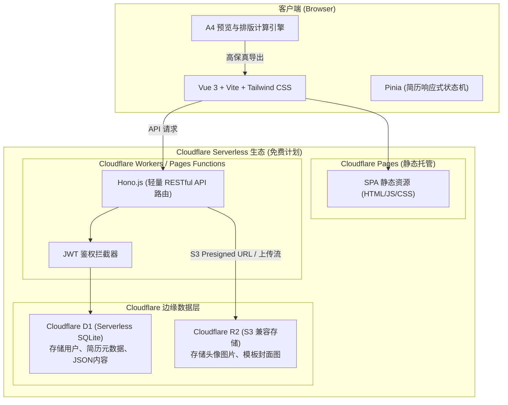
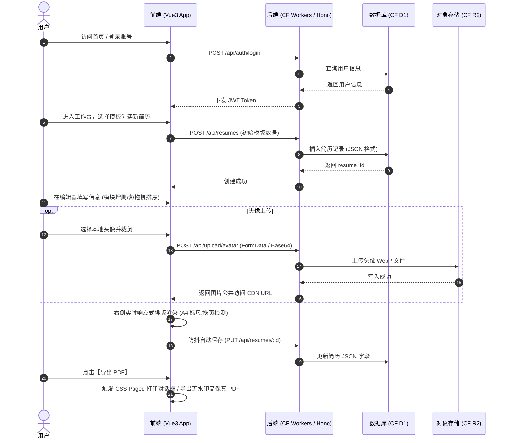
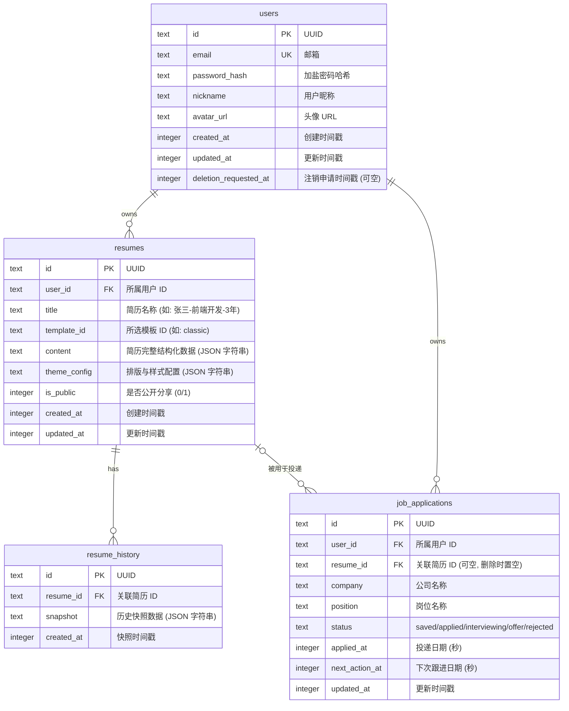

# 极简智能简历平台 (OpenResume) 产品需求文档 (PRD)

| 文档版本 | 状态 | 编写日期 | 适用范围 |
| :--- | :--- | :--- | :--- |
| v1.0.0 | 初稿 (MVP 规划) | 2026-09-27 | Web 前后端、Cloudflare Serverless 架构 |

---

## 1. 项目背景与产品定位

### 1.1 项目背景
求职过程中，一份排版专业、信息清晰的简历是求职者的敲门砖。当前国内主流简历制作平台（如超级简历 WonderCV、知页简历、木及简历等）大多体验良好，但普遍存在强制付费导出、高额会员订阅、导出格式错乱、数据隐私受限等痛点。

本项目旨在打造一款开源/轻量级、体验接近国内一线水准的现代化简历制作 Web 应用，**前后端完全基于 Cloudflare 免费生态部署**，以零服务器运维成本、全球边缘加速为特色，提供“开箱即用、所见即所得、自由导出”的纯粹制作体验。

### 1.2 产品定位
- **定位**：轻量级、高颜值、所见即所得的极简简历制作工具。
- **目标用户**：应届毕业生、互联网/泛技术从业者、白领求职者。
- **核心卖点**：
  - **国内主流交互体验**：左侧模块化内容表单 + 右侧实时 A4 纸张排版渲染（自适应缩放与分页标线）。
  - **零成本云原生架构**：全面拥抱 Cloudflare Pages + Workers + D1 + R2 免费套餐。
  - **模板内容解耦**：换模板不丢失/不破坏内容数据，支持个性化主题色与排版微调。
  - **高质量 PDF 导出**：无水印、高保真矢量打印/渲染导出。
  - **多格式导出与导入**：除 PDF 外支持 Word（.docx）、Markdown 与 JSON 备份；可从 JSON 备份、粘贴文本或 Markdown 导入。
  - **内容体检与岗位对照**：逐条检查量化数据、弱动词、占位符与长度；粘贴 JD 后按词频权重对照关键词覆盖，只提示不自动改写。

---

## 2. 竞品参考与核心差异化

| 维度 | 超级简历 / 知页简历 | 本项目 (MVP) |
| :--- | :--- | :--- |
| **交互模式** | 左侧结构化录入，右侧 A4 真实比例预览 | 采用相同的“左右双栏 / 单栏切换”交互，保证最佳编辑习惯 |
| **排版引擎** | 严谨的单页/多页自适应，自动优化间距 | 基于 CSS Paged Media + 虚拟 A4 高度检测，支持一键页面对齐 |
| **模板与收费**| 少数基础模板免费，精美模板/导出限制收费 | 内置 4 套高质量模板（含 ATS 友好型），完全免费无水印 |
| **部署与成本**| 传统云主机 + 集中式数据库，成本高 | Cloudflare Workers + D1 + R2，永久免费计划覆盖个人与中小流量 |

---

## 3. 技术架构与选型



### 3.1 技术栈清单
- **前端技术栈**：
  - 核心框架：Vue 3 (Composition API, `<script setup>`)
  - 构建工具：Vite
  - UI 与样式：Tailwind CSS + Lucide Vue Next (图标库)
  - 状态管理：Pinia
  - 路由管理：Vue Router 4
  - 拖拽排序：`vuedraggable` (基于 Sortable.js)
  - PDF 导出方案：
    - 方案 A（首选/最高清）：基于浏览器原生打印引擎 `@media print` 调起无损矢量打印为 PDF。
    - 方案 B（辅助降级）：客户端 `html2pdf.js` / `jspdf` + `html2canvas` 导出。
- **后端技术栈**：
  - 运行环境：Cloudflare Workers / Pages Functions (Edge Runtime)
  - 服务端框架：[Hono](https://hono.dev/) (专为边缘计算优化的 Web 框架，轻量高性能，仅几 KB)
  - 接口规范：RESTful API，JSON 交互
  - 认证方案：轻量 JWT (HMAC-SHA256) + Web Crypto API
- **存储方案**：
  - 结构化数据：**Cloudflare D1** (Serverless SQLite)，用于存储用户账号信息、简历 JSON 树、模板配置。
  - 二进制与对象存储：**Cloudflare R2**，用于用户头像图片上传与裁剪存储（免费额度 10GB，免出口流量费）。

### 3.2 Cloudflare 免费配额适配评估
- **D1 免费额度**：每天 500 万行读取、10 万行写入，总容量 5GB。
  - *应对方案*：简历编辑过程采用**前端防抖 3 秒 + 手动保存**结合，大幅降低写频次。
- **R2 免费额度**：10GB 存储，每月 100 万次写（Class A）、1000 万次读（Class B），出口流量完全免费。
  - *应对方案*：前端对头像在 Canvas 中进行预缩放和 WebP 压缩（限定不超过 200KB），直接节省空间。
- **Workers 免费额度**：每天 10 万次请求，10ms CPU 时间/请求。
  - *应对方案*：前端静态资源托管在 Cloudflare Pages（无限流量），仅业务 API 走 Workers，轻量 Hono 处理纯 JSON 耗时 < 3ms。

---

## 4. 用户角色与业务主流程

### 4.1 用户角色
- **访客**：未登录用户，可进入首页体验模板预览、试用在线编辑器（本地 LocalStorage 存储），导出前引导注册/登录或直接临时导出。
- **注册求职者**：拥有个人账号，简历数据实时云端持久化，支持多份简历管理、头像云存储。

### 4.2 核心业务流程图



---

## 5. 功能需求规格说明 (MVP 核心范围)

### 5.1 模块结构与划分

```
极简简历平台 (MVP)
├── 1. 用户与认证系统
│   ├── 邮箱/密码注册与登录
│   └── 退出登录与登录态维持 (JWT)
├── 2. 简历管理看板 (Dashboard)
│   ├── 我的简历列表 (新建、重命名、复制、删除)
│   └── 模板库中心 (缩略图展示、一键应用)
├── 3. 核心简历编辑器 (Core Editor)
│   ├── 3.1 左侧结构化编辑面板 (表单输入 + 模块控制)
│   ├── 3.2 右侧实时 A4 预览画布 (所见即所得 + 缩放自适应)
│   ├── 3.3 顶部控制工具栏 (模板切换、样式设置、状态提示、操作区)
│   └── 3.4 模块拖拽排序与显隐开关
├── 4. 存储与多媒体服务
│   ├── 头像本地裁剪与压缩
│   └── Cloudflare R2 头像存储与访问
├── 5. 导出与排版工具
│   ├── 浏览器原生矢量打印导出 (A4 标准无缝分页)
│   └── 页面高度警告与自动一页纸排版辅助
├── 6. 投递管理 (Job Tracker)
│   ├── 投递记录看板 (想投 / 已投递 / 面试中 / 已录用 / 未通过)
│   ├── 关联简历、渠道、薪资范围与岗位链接
│   └── 跟进提醒与面试率 / Offer 率统计
├── 7. 示例与获客 (SEO)
│   ├── 6 个岗位示例页 (真实模板渲染 + 写法建议)
│   └── robots / sitemap / 结构化数据 / 构建期 head 预渲染
├── 8. 离线与安装 (PWA)
│   ├── Service Worker 预缓存应用壳与静态资源
│   ├── 断网可打开、可编辑、可打印
│   └── 安装引导与新版本提示
├── 9. 账号与数据 (Account & Data)
│   ├── 修改密码 (需校验当前密码)
│   ├── 导出我的数据 (单个 JSON)
│   └── 注销账号 (邮箱二次确认 + 7 天冷静期 + 级联删除)
├── 10. 可观测性 (Observability)
│   ├── 前端错误上报与 Web Vitals（匿名聚合）
│   ├── 业务埋点（浏览 / 创建 / 保存 / 导出 / 分享 / 登录注册）
│   └── 服务端结构化日志 + 请求 ID + 阈值告警脚本
└── 11. AI 改写 (AI Rewrite)
    ├── 用户自带 Key 接入 12 家国内主流厂商 + 自定义 OpenAI 兼容端点
    ├── 七种改写风格（润色/精简/突出成果/STAR/专业措辞/纠错/译英）
    └── diff 对照 + 人工采纳，服务端不落库 Key 与正文
```

---

### 5.2 核心功能详细说明

#### 模块一：用户与认证模块
- **注册/登录**：
  - 邮箱 + 密码注册，密码经 PBKDF2 加盐哈希后存入 D1；邮箱统一 `trim().toLowerCase()` 归一，密码长度 6–128。
  - JWT Token 机制：有效期 7 天，保存在前端 `localStorage`，请求通过 `Authorization: Bearer <token>` 传递。
  - 注册需显式勾选服务条款与隐私政策（默认不勾，未勾不发请求）；登录不要求重复勾选。
  - **游客草稿处理**：登录成功后，若本机存在尚未上云的草稿，先询问「同步到云端 / 仅保留本地」，不静默上传。
  - *MVP 范围*：暂不接入繁琐的第三方微信扫描/短信验证码，使用简单可靠的邮箱+密码体系。

#### 模块二：简历管理看板 (Dashboard)
- **简历列表卡片**：
  - 展示模板版式缩略图（纯 CSS 表达单栏/双栏、有无头像、有无强调色，不加载真实模板组件）、简历名称、最后更新时间、所用模板与公开状态。
  - 展示**完整度进度条**：0–100 由服务端按「招聘方一定会看的信息」加权算出，并提示「还缺 姓名/联系方式…」。只判断信息填没填，不评价写得好不好。
  - 展示在线访问统计入口：累计浏览、平均停留，点击打开明细弹窗。
  - 操作支持：【编辑】、【重命名】、【复制一份】、【删除】、【开启/关闭公开分享】、【分享设置】、【打开在线只读页】。
- **视图密度**：网格 / 列表两种视图可切换，偏好记在本地。简历一多时列表模式一屏能扫十几份。
- **新建简历**：四步向导——选模板 → 选起点（空白 / 示例数据 / 从已有复制）→ 命名 → 确认。选「从已有复制」时自动带出源简历的模板与「xxx - 副本」标题。
- **空态**：双 CTA——「新建第一份简历」与「先看示例简历」。
- **投递管理入口**：页头提供「投递管理」按钮跳转 `/jobs`。

#### 模块三：核心简历编辑器 (最核心)
参考超级简历的交互布局，采用经典 **左右分栏布局**：

##### 1. 左侧结构化编辑抽屉/面板
支持标准模块录入，每个模块可增删条目、拖拽排序、开启/隐藏：
- **基本信息 (Basic Info)**：
  - 姓名、求职意向/职位名称、手机号码、电子邮箱、所在城市、工作年限、期望薪资（可选）。
  - 头像支持：点击上传、圆形/方形切换、隐藏头像开关。
  - 社交链接/个人主页（GitHub、技术博客、作品集）。
- **教育经历 (Education)**：
  - 学校名称、专业、学历（大专/本科/硕士/博士等）、起止时间、主修课程/成绩排名。
- **工作/实习经历 (Work Experience)**：
  - 公司名称、职位、部门、起止时间、工作内容与产出（支持 STAR 法则分点描述，具备加粗/斜体/无序列表等微型富文本能力）。
- **项目经历 (Projects)**：
  - 项目名称、担任角色、起止时间、项目链接、项目描述、核心贡献。
- **专业技能 (Skills)**：
  - 标签化或纯文本分段录入（如前端技能、后端技能、英语水平等）。
- **自定义模块 (Custom Sections)**：
  - 允许用户添加 1~2 个自定义模块（如“荣誉奖项”、“自我评价”、“个人证书”）。
- **模块管理面板**：
  - 支持上下拖拽改变模块在简历上的先后排版顺序（例如：刚毕业学生可将教育经历排在工作之前；资深人士可将工作经验排在第一位）。

##### 2. 右侧实时 A4 预览画布 (Preview Canvas)
- **真实比例画布**：
  - 标准国际 A4 纸张比例（宽 210mm × 高 297mm，按当前屏幕 DPI 缩放渲染）。
  - 页面底部提供画布缩放控件：`50% ~ 150%` 或“自适应屏幕宽度”。
- **分页指示线 (Page Breaks Detector)**：
  - 当内容超出 1 页（297mm）高度时，画布呈现动态红色/虚线【第 1 页截断线】，并提示用户调整内容或进入多页模式。
- **即时响应**：
  - 左侧表单任何按键输入，右侧无延迟更新（Pinia 状态驱动）。

##### 3. 顶部全局控制工具栏 (Editor Toolbar)
- **模板切换**：抽屉式切换内置 3 套模板。
- **排版微调器 (Theme & Layout Settings)**：
  - **主题色**：预置 8 种高雅商务色系（商务蓝、远峰蓝、雅致黑、橄榄绿、酒红等），支持自定义 Hex 色值。
  - **字号阶梯**：紧凑 (12px) / 标准 (14px) / 宽松 (15px)。
  - **段落与行间距**：`1.2` / `1.4` / `1.6`。
  - **模块垂直间距**：支持滑块微调，方便用户“一键填满一页纸”或“紧缩防超页”。
  - **页边距控制**：紧凑 (15mm) / 适中 (20mm) / 宽松 (25mm)。
- **状态提示**：
  - 自动显示“已保存到云端”或“草稿保存中...”。
- **动作按钮**：
  - 【预览】、【清空示例】、【导出 PDF】。

#### 模块四：内置模板体系（4 套）
1. **经典通用型 (Classic)**：黑白灰 + 商务强调色，顶部个人信息居中，横线分割各模块，适合绝大部分行业。
2. **极简极客型 (Geek / Minimal)**：左对齐，弱化边框线，强化技能标签与代码风格链接，极度适合程序员/技术岗位。
3. **现代双栏型 (Modern Sidebar)**：左侧侧栏展示个人信息、技能、语言；右侧主栏展示经历与项目，视觉层次分明。
4. **ATS 友好型 (Single Column)**：单栏纯文本，无图标、无头像、无强调色，面向只接受 .docx/PDF 解析的招聘系统与校招网申。

所有模板共用 `src/templates/resume.css` 定义的 `--rs-*` CSS 变量与 `.rs-*` 语义类，
字号、行高、颜色、间距均由排版配置驱动，模板本身只保留布局差异。

**模板与语言正交**：四套模板都能渲染中文或英文简历，不需要单独的「英文模板」。
简历语言由 `content.locale` 决定（`zh-CN` 默认 / `en`），只影响文档呈现——
模块标题、日期格式（`2022.07 – 至今` / `07/2022 – Present`）、列表分隔符（`、` / `, `）、
括号（全角 / 半角）。用户自己写的内容不会被翻译，也不会被改写。

- **模块标题的替换规则**：只替换「仍等于某个语言默认值」的标题。用户手写成「核心项目与产出」
  后切换语言，标题保持不变——数据里没有「是否改过」的标记，这是唯一可靠的判断依据。
- **技能呈现形态**（`modules.skills.type`）：`sentence`（整句描述，逐行列出）或 `tag`（胶囊标签）。
  两套模板的默认不同（Classic 默认整句、Geek/Modern 默认标签），用户可随时切换，不需要重录。
  ATS 模板始终输出一行纯文本——胶囊标签在解析器里会被切成碎片。

#### 模块五：导出与导入

**导出（编辑器「导出」按钮 → 格式弹窗）**

| 格式 | 生成方式 | 适用场景 |
| :--- | :--- | :--- |
| PDF | 浏览器原生打印（`@media print`），用户选择「另存为 PDF」 | 投递主渠道，矢量文字可复制、链接可点击 |
| Word (.docx) | 前端动态 `import('docx')` 生成 ATS 单栏版式 | 招聘系统要求上传 Word |
| Markdown (.md) | 纯文本结构，按 `modulesOrder` 输出标题与 bullet | 粘贴到邮件、笔记、网申文本框 |
| JSON | 完整备份（含排版配置与头像） | 换设备、换浏览器时原样恢复 |

- 打印相关选项：省墨模式（去掉背景色块）、保留链接文字（关闭后外链渲染为纯文本）。
- 文件名统一为 `姓名_求职意向_年限`，非法字符替换为下划线。
- **导出跟随简历语言**：英文简历的 Markdown 用 `## Summary` / `Link:`、列表用逗号分隔；
  Word 用 Calibri 字体与英文文档属性。

**导入（「更多」菜单 → 导入简历）**

| 来源 | 解析方式 |
| :--- | :--- |
| OpenResume JSON | 校验 `schema: openresume/resume` 与版本号，往返无损 |
| 粘贴文本 | 按「工作经历 / 项目 / 教育 / 技能」中英文关键词分节，按日期行切条目 |
| Markdown | 先剥离 `#` 层级前缀，再走纯文本解析 |

导入结果先展示预览，用户确认后才写入当前简历；导入前提示先保存版本快照。

#### 模块六：内容体检与岗位对照
- **内容体检**：逐条检查 bullet 是否含量化数据、是否以弱动词开头（负责/协助/参与）、是否超长、是否残留占位符、是否空洞。每条规则可单独开关，命中项按经历分组展示。
- **岗位对照**：粘贴 JD 后按词频权重计算关键词覆盖率（任职要求权重 1.0、岗位职责 0.5），同义词（Vue3/Vue.js、K8s/Kubernetes 等）已归一。只给出「覆盖充分 / 部分 / 缺口较多」三档描述与具体缺失词，不折算成 0–100 通过分，也不提供「一键写入技能栏」。

#### 模块七：投递管理 (Job Tracker)

投简历之后的「然后呢」：投了哪家、用的哪份简历、进展到哪一步、下次什么时候跟进。不接招聘渠道、不发邮件——那些需要第三方账号与回调，收益远小于复杂度。

- **五种状态**：想投（`saved`）/ 已投递（`applied`）/ 面试中（`interviewing`）/ 已录用（`offer`）/ 未通过（`rejected`）。状态存字符串而非枚举整数，加新状态不需要迁移。
- **记录字段**：公司（必填）、岗位（必填）、城市、投递渠道（官网/内推/招聘平台/猎头/线下）、关联简历、投递日期、下次跟进日期与备注、薪资范围、岗位链接、自由备注。
  - 「已投递」且未填日期时，服务端默认记成当天——空着会让看板上的时间线断掉。
- **两种视图**：看板（按状态五列）与列表，偏好记在本地。看板卡片的「更多操作」可直接移到其他状态或编辑/删除。
- **跟进提醒**：`nextActionAt` 在 7 天内（含已逾期）且状态不是「已录用/未通过」的记录，顶部汇总成一张提醒卡，按到期时间升序取前 5 条。
- **汇总统计**：已投递数、面试率、Offer 率、待跟进数。
  - 面试率 = `(面试中 + 已录用) / 已投递`，Offer 率 = `已录用 / 已投递`；**分母不含「想投」**——把它算进分母会让转化率低得没有参考价值。分母为 0 时显示 0%，不显示 `NaN%`。
  - 统计由服务端一次算好随列表返回，前端不重复计算口径。
- **按简历筛选**：可按关联简历过滤，回答「这份简历投出去后转化如何」。
- **删除**：二次确认，且不影响简历本身；删除简历时投递记录保留（`resume_id` 置空），求职历史不该随简历一起消失。

#### 模块八：示例库与搜索获客 (SEO)

让「还没决定用不用」的人先看到成品，也让搜索引擎有可索引的落地页。

- **6 个岗位示例**：前端、后端、产品、运营、应届生、外企英文。每个示例包含「这份示例强调什么」三条要点与三条写法建议。
- **真实渲染**：示例页右侧挂的是真实模板组件（`TemplatePreview`），不是截图——模板改版后示例自动同步，不会出现过期图片。
- **一键开始**：按钮带 `template` 与 `locale` 进编辑器，得到该语言的完整范文；**不把示例内容写进草稿**——示例是写法参考，直接当初始内容会让用户面对一堆要删的假经历。
- **可索引性**：
  - `/examples` 与 `/examples/:slug` 公开可抓取，未知 slug 走 404（不静默回落成列表，否则会产生重复内容）。
  - `public/robots.txt` 显式禁掉 `/editor/`、`/dashboard`、`/jobs`、`/api/` 与分享路径 `/share/`、`/s/`。
  - `public/sitemap.xml` 只收录 10 个公开页面，由静态守卫校验「示例数据新增后必须同步 sitemap」。
- **构建期 head 预渲染**：`scripts/prerender.mjs` 在 `npm run build` 末尾为 10 个营销页各写一份带正确 `<title>`/`description`/OG/JSON-LD 的静态 HTML。正文仍由 JS 渲染——社交爬虫只读 head，正文不需要 SSR。
- **结构化数据**：首页 `SoftwareApplication` + `FAQPage`（FAQ 与页面展示同源，避免「结构化数据写了页面没有」），示例页 `BreadcrumbList`。不写 `aggregateRating`——没有真实评分时不编造。

#### 模块九：离线与安装 (PWA)

「本地优先」不是口号：装过一次之后，断网也能打开编辑器继续写。

- **预缓存**：Service Worker 在首次访问时缓存应用壳（HTML/JS/CSS/字体/图标）与全部预渲染页面（构建后 88 条、约 1MB，随产物略有变化）。之后的导航直接命中缓存，断网刷新不会白屏。
- **不缓存简历数据**：`/api/**` 一律不进缓存——简历是私有内容，缓存会让换账号后读到上一个人的数据，也会让「已保存」失去意义。头像例外（`CacheFirst`，60 条 / 30 天），因为它是不变的静态资源。
- **离线编辑与打印**：草稿本来就存在 IndexedDB，断网时照常编辑；打印走浏览器原生 `@media print`，不依赖网络。联网后由既有的自动保存队列补写云端，不另设一套重试逻辑。
- **安装引导**：只在浏览器真的抛出 `beforeinstallprompt` 时显示「安装到桌面」。Chrome 的安装条件（HTTPS、manifest、SW、图标）不满足就不会触发，不去猜「应该可以装了」。
- **新版本提示**：发现新版本时弹常驻提示，**不自动刷新**——编辑器里可能有未保存内容，静默 reload 等于丢数据。用户点「刷新更新」后才激活新 SW 并重载。
- **iOS**：`manifest` 里的 icons 不被 iOS 读取，单独声明 `apple-touch-icon` 与全屏 meta。

#### 模块十：账号与数据 (Account & Data)

用户对自己的账号有完整的处置权：改密码、带走数据、注销。

- **修改密码**：必须提供当前密码（只有 JWT 不够——token 泄露不该直接升级成账号永久接管）；新密码 6–128 位且不能与当前密码相同。改密后旧 token 仍有效，这是明确取舍（见执行状态 T5.5 偏差 3）。
- **导出我的数据**：`GET /api/auth/export` 返回一份 JSON 附件，包含简历正文与主题、版本历史、分享链接、投递记录与账号基本信息；**不含** `password_hash`，也**不含**访问统计（那是访客的行为数据）。文件名形如 `openresume-<email>-<YYYY-MM-DD>.json`。
- **注销账号**：
  - 必须原样输入账号邮箱并二次确认，避免误点把账号送进删除倒计时。
  - 提交后进入 **7 天冷静期**，期间账号可正常使用，页面顶部显示剩余天数横幅。
  - **冷静期内登录即自动撤销**——能登进来就说明用户后悔了，不再让他去找撤销入口。
  - 到期后：登录时惰性删除（返回 `40105`），或由 `npm run db:purge:remote` 定时清理。删除范围覆盖简历、版本、分享链接、投递记录、访问记录与用户行。
- **数据保留**：访问记录保留 180 天，每份简历保留 20 个版本，限流窗口行保留 1 天；三者由同一个清理脚本统一回收。
- **暂不提供**：邮件验证与密码重置。两者都依赖邮件服务商凭据（Resend / Cloudflare Email Routing），仓库中不应存在、本地也无法验证完整链路；与其做一个发不出邮件的假实现，不如把入口保持移除。

#### 模块十一：可观测性 (Observability)

「出问题时能不能立刻知道、能不能定位」是产品的一部分：首页白屏比保存失败严重得多，
但没有数据就只能等用户来投诉。

- **不接第三方**：没有 Sentry / GA / 任何外域脚本。上报统一发到本站的 `/api/telemetry`，
  自建的好处是「隐私政策里写的每一条都能在仓库里核对」，也少一次对第三方 SDK 的审计。
- **前端错误**：`window.onerror` + `unhandledrejection`。错误信息在浏览器端就把邮箱与手机号
  替换成 `<email>` / `<phone>`，只保留 200 字符。
- **Web Vitals**：LCP / CLS / INP 三个值，页面隐藏（`pagehide` / `visibilitychange`）时用
  `sendBeacon` 发出——普通 `fetch` 在页面卸载后大概率被浏览器取消。
- **业务埋点**：`page.*`（按**路由名**，不是路径）、`resume.create.*`、`resume.save.*`、
  `export.<格式>.ok|fail`、`share.*`、`auth.*`。只记「发生了几次」，不记是谁、不记内容。
- **只存聚合**：`telemetry_daily` 按「日期 × 类别 × 事件名 × 归一化路径」累加计数，
  没有 `user_id`、没有 IP、没有原始事件。保留 90 天。
- **服务端**：每个请求一个 `X-Request-Id`，完成后输出一行 JSON 结构化日志（不记请求体与查询串）；
  登录失败、注册成功、5xx 同时写入聚合表。
- **告警口径**：导出失败率 > 5%、登录失败率 > 40%、5xx > 20 次/天，分母 < 10 不判定。
  数据都在 `telemetry_daily` 一张表里，需要时手工查库；项目不附带自动巡检。
- **尊重 DNT/GPC**：用户开启「请勿追踪」或「全局隐私控制」时，前端完全不采集。

#### 模块十二：AI 改写 (AI Rewrite)

定位是**文字层面的改写建议**，不是内容生成。这条界线决定了整个功能的形态：
简历是会被面试官逐条追问的东西，模型顺手补一个「提升 30%」就可能让人当场露馅，
所以「不得编造事实」写在系统提示词的第一条，且不交给风格定义去调。

- **用户自带 Key**：本站不提供、不代管、不售卖模型额度，成本完全由用户与其服务商结算。
  因此这个功能对我们零边际成本，也不必限制用量档位。
- **12 家国内主流厂商预设**：DeepSeek、阿里云百炼、智谱 GLM、月之暗面 Kimi、火山方舟、
  百度千帆、腾讯混元、讯飞星火、硅基流动、MiniMax、阶跃星辰、百川智能，外加一个自定义。
  全部走 OpenAI 兼容协议，一套代码覆盖，不为每家写适配器。
- **自定义厂商**：任何 OpenAI 兼容端点（自建网关、公司内网代理、Ollama、vLLM、One-API）。
- **模型名不写死**：厂商改名频繁（`glm-4-plus` → `glm-5`），模型名始终可手改，也能一键
  从厂商拉实时清单。预设只负责「首次能跑起来」。
- **七种风格**：润色通顺 / 精简压缩 / 突出成果 / STAR 结构 / 专业措辞 / 纠错校对 / 译成英文。
  用户选一个词即可，不必自己写 prompt。
- **必须人工确认**：结果先以「原文 / 改写」diff 呈现（行级 + 词级、+/− 字数汇总），
  点「采纳改写」才写回正文，点「放弃」则一字不动。切换段落会清掉上一段的结果，
  避免 A 段的结果被采纳进 B 段。
- **缺数据就标出来**：原文没有量化数据时，模型插入 `[请补充具体数据]` 占位符，
  而不是自己编一个数字——这条给出了「确实缺数据」时的正确出口。
- **隐私边界**：只送用户选中的那一段（≤ 2000 字），只有他主动点按钮时才发；
  Key 与正文**不落库、不写日志**；服务端只记 `provider / style / target / 字数区间`。
- **经服务端转发**：站点 CSP 是 `connect-src 'self'`（这条规则同时保证了「页面不会偷偷
  把简历发给第三方」），且大多数国内厂商不返回 CORS 头，浏览器直连本来也不可行。
  代价是 Key 会过一次服务端内存，用「不落库 + 不写日志 + 不校验登录 + 限流」压到最小，
  并在用户填 Key 的地方把这件事说明白，而不是藏在隐私政策里。
- **自定义地址必须设防**：用户能自定义 base URL 就等于能让我们替他发请求，
  因此预设厂商只认白名单地址、自定义仅允许 https 并拦截内网与保留网段、
  上游请求不跟随 3xx 跳转。
- **错误要能指导行动**：Key 无效 / 地址或模型名不存在 / 限流或余额不足 / 超时……
  各有独立错误码并附服务商原话。**刻意不用 401**——「Key 填错」与账号无关，
  用 401 会被前端当作登录态失效而把人踢下线。

---

## 6. 数据结构与数据库设计 (Cloudflare D1)

系统使用 Cloudflare D1 (SQLite) 存储核心数据。

### 6.1 ER 图与表关系



> 完整 10 张表（含 `share_links`、`visits`、`resume_versions`、`rate_limits`、`telemetry_daily`、`schema_migrations`）以 [`schema.sql`](./schema.sql) 为准，本图只画核心关系。

### 6.2 DDL 建表 SQL 语句 (`schema.sql`)

```sql
-- 1. 用户表
CREATE TABLE IF NOT EXISTS users (
    id TEXT PRIMARY KEY,
    email TEXT UNIQUE NOT NULL,
    password_hash TEXT NOT NULL,
    nickname TEXT,
    avatar_url TEXT,
    created_at INTEGER NOT NULL DEFAULT (unixepoch()),
    updated_at INTEGER NOT NULL DEFAULT (unixepoch()),
    deletion_requested_at INTEGER      -- 注销申请时间；NULL 表示未申请
);
CREATE INDEX IF NOT EXISTS idx_users_email ON users(email);
CREATE INDEX IF NOT EXISTS idx_users_deletion ON users(deletion_requested_at);

-- 2. 简历主表
CREATE TABLE IF NOT EXISTS resumes (
    id TEXT PRIMARY KEY,
    user_id TEXT NOT NULL,
    title TEXT NOT NULL DEFAULT '未命名简历',
    template_id TEXT NOT NULL DEFAULT 'classic',
    content TEXT NOT NULL,          -- 核心简历 JSON
    theme_config TEXT NOT NULL,     -- 样式排版 JSON (字体/颜色/间距)
    is_public INTEGER NOT NULL DEFAULT 0,
    created_at INTEGER NOT NULL DEFAULT (unixepoch()),
    updated_at INTEGER NOT NULL DEFAULT (unixepoch()),
    FOREIGN KEY (user_id) REFERENCES users(id) ON DELETE CASCADE
);
CREATE INDEX IF NOT EXISTS idx_resumes_user ON resumes(user_id);

-- 3. 简历历史版本表 (为后续版本撤销/回滚预留)
CREATE TABLE IF NOT EXISTS resume_history (
    id TEXT PRIMARY KEY,
    resume_id TEXT NOT NULL,
    snapshot TEXT NOT NULL,
    created_at INTEGER NOT NULL DEFAULT (unixepoch()),
    FOREIGN KEY (resume_id) REFERENCES resumes(id) ON DELETE CASCADE
);
CREATE INDEX IF NOT EXISTS idx_history_resume ON resume_history(resume_id);

-- 10. 可观测性聚合 (只存计数，无 user_id / IP / 原始事件)
CREATE TABLE IF NOT EXISTS telemetry_daily (
    day TEXT NOT NULL,                    -- UTC 日期 YYYY-MM-DD
    kind TEXT NOT NULL,                   -- error | vital | event | server
    name TEXT NOT NULL,                   -- 事件名（如 export.pdf.ok）
    path TEXT NOT NULL DEFAULT '',        -- 归一化路径（/editor/:id）
    count INTEGER NOT NULL DEFAULT 0,
    total_value REAL NOT NULL DEFAULT 0,  -- vital 的累加值，均值 = total_value / count
    PRIMARY KEY (day, kind, name, path)
);
CREATE INDEX IF NOT EXISTS idx_telemetry_day ON telemetry_daily(day);
```

### 6.3 简历数据核心 JSON Schema (`content` 字段结构定义)

```json
{
  "profile": {
    "name": "张小凡",
    "title": "资深前端工程师",
    "email": "xiaofan@example.com",
    "phone": "13800138000",
    "location": "北京·海淀",
    "avatar": "https://r2.yourdomain.com/avatars/xxxx.webp",
    "showAvatar": true,
    "github": "https://github.com/example",
    "website": "https://blog.example.com",
    "summary": "5年前端开发经验，精通Vue3与微前端架构..."
  },
  "modulesOrder": ["education", "work", "projects", "skills", "custom"],
  "modules": {
    "education": {
      "visible": true,
      "title": "教育背景",
      "items": [
        {
          "id": "edu-1",
          "school": "北京航空航天大学",
          "major": "计算机科学与技术",
          "degree": "硕士",
          "startDate": "2019-09",
          "endDate": "2022-06",
          "description": "GPA: 3.8/4.0，获得国家奖学金"
        }
      ]
    },
    "work": {
      "visible": true,
      "title": "工作经历",
      "items": [
        {
          "id": "work-1",
          "company": "某知名互联网大厂",
          "department": "核心研发部",
          "position": "前端技术专家",
          "startDate": "2022-07",
          "endDate": "至今",
          "description": "• 负责低代码平台核心渲染引擎设计与研发；\n• 页面加载性能提升 40%，首屏耗时降至 800ms。"
        }
      ]
    },
    "projects": {
      "visible": true,
      "title": "项目经验",
      "items": [
        {
          "id": "proj-1",
          "name": "企业级协同设计系统",
          "role": "核心架构师",
          "startDate": "2023-01",
          "endDate": "2023-10",
          "link": "https://project.example.com",
          "description": "基于 Canvas 与 WebAssembly 实现的高性能在线制图引擎。"
        }
      ]
    },
    "skills": {
      "visible": true,
      "title": "专业技能",
      "items": [
        "熟练掌握 Vue3 / TypeScript / Vite 现代前端工程化生态体系",
        "深入理解浏览器渲染机制与前端前沿性能调优方案",
        "具备全栈开发视野，熟悉 Node.js / Hono 及 Serverless 边缘计算架构"
      ]
    },
    "custom": {
      "visible": false,
      "title": "荣誉奖项",
      "items": [
        "2023 年度优秀员工",
        "全国大学生程序设计竞赛 (ACM-ICPC) 铜牌"
      ]
    }
  }
}
```

### 6.4 样式排版 JSON Schema (`theme_config` 字段结构定义)

```json
{
  "themeColor": "#2563EB",
  "fontFamily": "font-sans",
  "fontSize": 14,
  "lineHeight": 1.5,
  "paragraphSpacing": 8,
  "sectionSpacing": 16,
  "pagePadding": 20,
  "showBorder": true
}
```

---

## 7. 后端 API 接口设计 (Hono on Cloudflare Workers)

所有接口统一以 `/api` 为前缀，返回格式统一为：
```json
{
  "code": 0,
  "message": "success",
  "data": {}
}
```

### 7.1 认证模块 (`/api/auth`)
| 方法 | 路径 | 鉴权要求 | 说明 |
| :--- | :--- | :--- | :--- |
| `POST` | `/api/auth/register` | 公开 | 邮箱+密码注册 |
| `POST` | `/api/auth/login` | 公开 | 邮箱+密码登录，返回 JWT Token & 用户信息 |
| `PUT` | `/api/auth/profile` | Bearer Token | 修改昵称与头像 |
| `GET` | `/api/auth/me` | Bearer Token | 获取当前登录用户的基本信息（含注销冷静期剩余天数） |
| `POST` | `/api/auth/password` | Bearer Token | 修改密码，需校验当前密码 |
| `GET` | `/api/auth/export` | Bearer Token | 导出账号数据为 JSON 附件 |
| `POST` | `/api/auth/deletion` | Bearer Token | 申请注销（需邮箱二次确认，7 天冷静期） |
| `DELETE` | `/api/auth/deletion` | Bearer Token | 撤销注销申请 |

### 7.2 简历管理与数据持久化 (`/api/resumes`)
| 方法 | 路径 | 鉴权要求 | 说明 |
| :--- | :--- | :--- | :--- |
| `GET` | `/api/resumes` | Bearer Token | 获取当前用户的所有简历列表（不含大文本 content） |
| `POST` | `/api/resumes` | Bearer Token | 创建一份新简历（可指定初始化模板及示例数据） |
| `GET` | `/api/resumes/:id` | Bearer Token | 获取单份简历的完整配置与内容数据 |
| `PUT` | `/api/resumes/:id` | Bearer Token | 保存更新简历（全量/增量保存 content 和 theme_config） |
| `DELETE` | `/api/resumes/:id` | Bearer Token | 删除指定简历 |
| `POST` | `/api/resumes/:id/duplicate`| Bearer Token | 复制当前简历为新的一份副本 |

### 7.3 文件上传 (`/api/upload`) - Cloudflare R2
| 方法 | 路径 | 鉴权要求 | 说明 |
| :--- | :--- | :--- | :--- |
| `POST` | `/api/upload/avatar` | Bearer Token | 上传头像文件，存储至 R2，返回公开 CDN 访问链接 |

### 7.4 投递管理 (`/api/jobs`)
| 方法 | 路径 | 鉴权要求 | 说明 |
| :--- | :--- | :--- | :--- |
| `GET` | `/api/jobs` | Bearer Token | 投递记录列表 + 汇总统计（面试率/Offer 率/待跟进） |
| `POST` | `/api/jobs` | Bearer Token | 新增投递记录（公司、岗位必填） |
| `PATCH` | `/api/jobs/:id` | Bearer Token | 局部更新（只改请求里出现的字段） |
| `DELETE` | `/api/jobs/:id` | Bearer Token | 删除记录 |

字段与统计口径见 [`接口文档.md`](./接口文档.md) 的 2.7 节。

### 7.5 AI 改写 (`/api/ai`)

| 方法 | 路径 | 鉴权要求 | 说明 |
| :--- | :--- | :--- | :--- |
| `POST` | `/api/ai/rewrite` | **公开（无需 Token）** | 按风格改写一段文字，返回候选文本（不落库） |
| `POST` | `/api/ai/models` | **公开（无需 Token）** | 从用户配置的厂商拉取实时模型列表 |

两个接口都用**用户自己的 API Key**，因此不需要账号（带上 `Authorization` 反而会让
「Key 错了」和「登录过期了」在错误分支里混在一起）；限流 30 次/分/IP。
厂商预设、风格枚举与长度上限的唯一来源是 `shared/ai.ts`，
请求/响应字段、错误码与安全边界见 [`接口文档.md`](./接口文档.md) 的 2.9 节。

---

## 8. 页面原型与交互视觉设计规范

### 8.1 页面清单与路由映射
| 页面名称 | 路由路径 | 核心组件/功能 |
| :--- | :--- | :--- |
| **首页 (Landing Page)** | `/` | 平台介绍、特色特性、四套模板真实预览、6 个岗位示例、FAQ、CTA「免费制作简历」 |
| **登录 / 注册** | `/login`、`/register` | 邮箱密码认证，Tab 与 URL 双向同步；注册需勾选条款 |
| **工作台 (Dashboard)** | `/dashboard` | 简历列表（缩略图 + 完整度 + 访问统计）、网格/列表切换、四步新建向导 |
| **编辑器页 (Editor)** | `/editor/:id` | 左侧多模块编辑面板、右侧实时 A4 分页纸张、顶部功能栏；移动端三 Tab（填写/预览/样式）+ 底部导出条 |
| **只读分享页 (Share)** | `/share/:id`、`/s/:token` | 独立纯净的简历只读预览页，支持访问密码、联系方式脱敏、在线打印 |
| **投递管理 (Jobs)** | `/jobs` | 投递看板/列表、跟进提醒、面试率与 Offer 率统计；需登录 |
| **简历示例库** | `/examples`、`/examples/:slug` | 6 个岗位示例（前端/后端/产品/运营/应届/外企英文），真实模板渲染 + 写法建议；公开可索引 |
| **账号设置 (Settings)** | `/settings` | 冷静期横幅、修改密码、导出我的数据、注销账号；需登录，页面 `noindex` |
| **隐私政策 / 服务条款** | `/privacy`、`/terms` | 合规文本，注册页与页脚互链 |
| **404** | 兜底路由 | 未匹配路径的友好提示与返回首页入口 |

> 可观测性没有独立页面：埋点随路由切换与服务端事件产生，数据从 `telemetry_daily` 直接查询。

### 8.2 核心编辑器页面布局设计 (Wireframe)

```
+-------------------------------------------------------------------------------------------------------+
|  [Logo] OpenResume | 简历: [张三-前端研发工程师 ✏️]   [云端已保存 11:42]  |  [模板切换] [排版设置] [导出 PDF]  |
+---------------------------------------------------+---------------------------------------------------+
|  <<< 左侧表单编辑区 (可滚动, 宽度 45%)             |  >>> 右侧实时 A4 预览画布 (居中, 宽度 55%)           |
+---------------------------------------------------+---------------------------------------------------+
|  [模块导航: 个人信息 | 教育 | 工作 | 项目 | 技能]  |      缩放控制: [ - ]  100%  [ + ]  [适应宽度]          |
|                                                   |                                                   |
|  ▼ 个人信息                                       |  +---------------------------------------------+  |
|  [上传头像] 姓名: [张小凡]  意向: [前端开发]        |  | 姓名: 张小凡              求职意向: 前端开发   |  |
|  电话: [138xxxx] 邮箱: [test@163.com]             |  | 电话: 13800000000        邮箱: test@163.com   |  |
|  GitHub: [https://...]                            |  |---------------------------------------------|  |
|                                                   |  | ■ 教育背景                                  |  |
|  ▼ 工作经历 [ + 添加一段 ]                        |  | 2019-2022  北京航空航天大学 · 计算机 (硕士)    |  |
|  -----------------------------------------------  |  |---------------------------------------------|  |
|  :: [某知名大厂]  职位: [前端开发] [2022 - 至今]   |  | ■ 工作经历                                  |  |
|     工作描述: [富文本/Markdown 分点支持...]       |  | 某知名大厂 · 前端开发 (2022-至今)            |  |
|  :: [某初创科技]  职位: [实习生]   [2021 - 2022]   |  | • 负责核心渲染引擎设计与研发...               |  |
|                                                   |  | • 优化首屏加载性能提升 40%...                 |  |
|  ▼ 项目经验 [ + 添加一段 ]                        |  |---------------------------------------------|  |
|  ...                                              |  | - - - - - - - - - A4 第 1 页截断线 - - - - -|  |
|                                                   |  | (若内容超出会在此清晰标注跨页位置)            |  |
|  [拖拽调整模块上下顺序 ↕]                         |  +---------------------------------------------+  |
+---------------------------------------------------+---------------------------------------------------+
```

---

## 9. 部署与实施方案 (全流程 Cloudflare 免费套件)

### 9.1 架构部署步骤
1. **Cloudflare D1 初始化**：
   - 使用 Wrangler CLI 创建 D1 数据库：`npx wrangler d1 create open-resume-db`
   - 执行 SQL 初始化：`npx wrangler d1 execute open-resume-db --file=./schema.sql`
2. **Cloudflare R2 存储桶初始化**：
   - 创建公开/绑权 Bucket：`npx wrangler r2 bucket create open-resume-assets`
   - 绑定自定义域名或启用 r2.dev 公开读取访问，配置 CORS 允许前端跨域加载图片。
3. **前端 (Cloudflare Pages)**：
   - 关联 GitHub 仓库，配置构建命令 `pnpm build`，输出目录 `dist`。
   - 享受全球边缘 Anycast 毫秒级 CDN 分发。
4. **后端 (Cloudflare Workers / Pages Functions)**：
   - 采用 Hono.js 编写，在 `wrangler.toml` 中绑定 D1 数据库实例及 R2 Bucket：
     ```toml
     [[d1_databases]]
     binding = "DB"
     database_name = "open-resume-db"
     database_id = "<your-d1-id>"

     [[r2_buckets]]
     binding = "BUCKET"
     bucket_name = "open-resume-assets"
     ```

---

## 10. 迭代规划与路线图 (Roadmap)

### Phase 1：MVP 核心版本 (当前阶段)
- [ ] 初始化项目骨架：Vue 3 前端 + Hono 后端 Workers 配置
- [ ] D1 数据库设计与建表，用户简易认证体系
- [ ] 核心简历状态机（Pinia）设计，支持结构化模块录入
- [ ] 左右分栏核心编辑器，实现第 1 套经典通用模板 (Classic)
- [ ] 实时 A4 渲染比例引擎与分页指示线计算
- [ ] 原生高保真无损 PDF 打印/导出适配
- [ ] 头像裁剪与 Cloudflare R2 边缘存储上传
- [ ] 自动化防抖保存与 D1 持久化

### Phase 2：体验进阶与多样性 (后续规划)
- [ ] 增加第 2、3 套模板（极简程序员风、双栏现代商务风）
- [ ] 模块拖拽排序 (`vuedraggable`) 体验调优
- [ ] 提供国内求职示例模版库（前端开发、产品经理、运营、应届生各一套标准范文）
- [ ] 支持在线一键生成公开只读分享链接 (`/share/:id`)

### Phase 3：智能化与生态扩展 (未来展望)
- [ ] 集成 Cloudflare Workers AI 或大模型 API，提供简历润色、STAR 格式重写、语法检查
- [ ] 多语言支持（中文/英文一键切换）
- [ ] 导入已有 JSON / Markdown 简历一键转换
