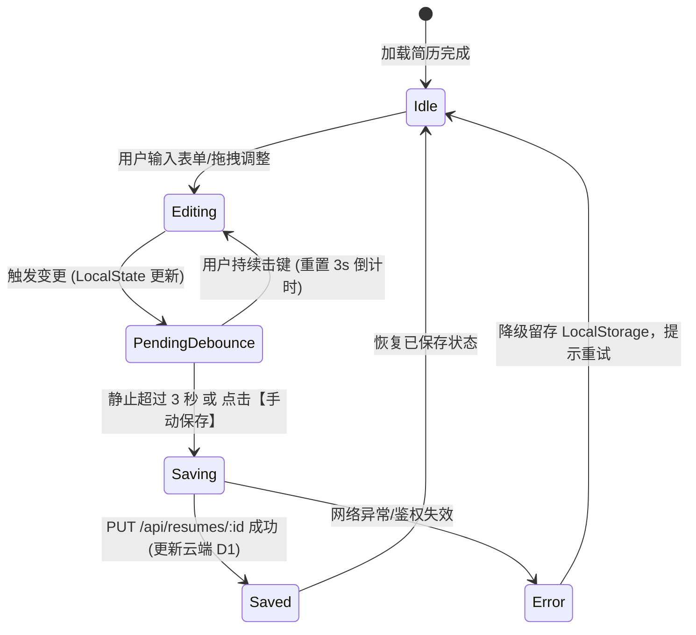

# 极简简历平台 (OpenResume) 详细需求规格说明书 (SRS)

| 规范文档编号 | 版本 | 编写日期 | 关联 PRD | 适用阶段 |
| :--- | :--- | :--- | :--- | :--- |
| SRS-2026-RESUME-001 | v1.0.0 | 2026-09-27 | [docs/产品需求文档.md](./产品需求文档.md) | MVP 详细设计、研发实现与测试验收 |

---

## 1. 概述与目标

### 1.1 文档定位
本文档作为 [docs/产品需求文档.md](./产品需求文档.md) 的落地执行细化版本，深度参考国内热门简历平台（**超级简历 WonderCV、知页简历、木及简历、牛客简历**）的成熟交互与排版机制，制定出涵盖**业务用例、字段规格、交互细节、异常处理、排版避让算法及验收指标**的高颗粒度需求规格，为前端 Vue 3、后端 Cloudflare Workers/D1/R2 的研发和 QA 测试提供直接依据。

### 1.2 核心术语与定义表
| 术语 / 标识 | 英文全称 / 代码符号 | 解释说明 |
| :--- | :--- | :--- |
| **A4 物理画布** | A4 Physical Canvas | 标准国际纸张尺寸（210mm × 297mm），在 96 DPI 下基准像素为 794px × 1123px。 |
| **分页截断线** | Page Break Indicator | 在预览画布中标识物理页面分割位置的动态辅助虚线，辅助排版。 |
| **防抖自动保存** | Debounced Auto-Save | 用户的击键操作在停止输入 3 秒后触发云端 D1 持久化，避免高频写入消耗免费配额。 |
| **STAR 原则** | Situation, Task, Action, Result | 国内求职简历经历描述的黄金法则，编辑器需提供对应辅助输入结构。 |
| **断页避让** | Break-Inside Avoidance | CSS 排版规则，防止一个工作经历子条目或标题行刚好被截断在两页的接缝处。 |
| **数据与视图解耦** | Data-View Decoupling | 简历数据采用通用 JSON 存储，切换不同风格模板时内容 100% 完整保留。 |

---

## 2. 用户角色与典型使用场景 (User Scenarios)

### 2.1 用户角色画像
1. **校招学生 / 实习生（小明）**：
   - *特点*：工作经历较少，容易出现“内容太少导致下半页空白”。
   - *核心诉求*：需要教育背景置顶、支持技能和校内活动重点展示，需要“一键适当放大行距/间距以填满一页纸”的能力。
2. **社招中高级工程师 / 泛技术求职者（李华）**：
   - *特点*：项目多、技术栈多、经历丰富，容易“内容刚好超出一页纸（1.1~1.2页）”。
   - *核心诉求*：需要突出技能清单、项目链接、STAR 法则条目，需要“紧凑排版微调”以精准收敛至整 1 页或整 2 页，且要求导出 PDF 必须支持外链点击与文字复制。
3. **免登录快速体验者（访客）**：
   - *特点*：不愿先注册，想直接看到编辑效果与导出质量。
   - *核心诉求*：打开即用，本地保存，满意后再注册同步。

---

## 3. 国内热门竞品核心功能参考与对标

| 竞品功能点 | 超级简历 (WonderCV) | 知页简历 | 本项目 (OpenResume) 落地规范 |
| :--- | :--- | :--- | :--- |
| **布局模式** | 左侧输入 + 右侧 1:1 预览 | 左右分栏 / 双击直接修改 | **左侧结构化表单 + 右侧 1:1 响应式 A4 画布**（输入效率高且稳定） |
| **排版优化** | 自动一页纸间距调节 | 预设间距挡位 | **支持预设挡位（紧凑/标准/宽松）+ 像素级微调滑块** |
| **内容建议** | STAR 提示、动词库 | 引导文案 | **每个经历模块内置 STAR 引导提示与优质范文占位符** |
| **导出控制** | 强制会员付费导出 PDF | 付费解锁水印 | **完全免费、无水印、原生高保真矢量打印/导出** |
| **跨页检测** | 动态标线与超页红线告警 | 简单分页符 | **动态智能换页线 + 元素级断页保护 (`break-inside: avoid`)** |

---

## 4. 详细功能需求规格 (Functional Specifications)

```
OpenResume 需求模块全景
├── F1. 用户账户与会话管理 (Auth & Session)
├── F2. 仪表盘与多简历管理 (Dashboard)
├── F3. 编辑器架构与全局工具栏 (Editor Layout & Toolbar)
├── F4. 简历各模块录入规格 (Resume Form Sections)
├── F5. 实时 A4 排版与预览引擎 (Render Engine)
├── F6. 样式与主题控制系统 (Style & Theme Settings)
├── F7. 模板渲染系统 (Template Engine)
├── F8. 头像与文件存储管理 (Cloudflare R2 Integration)
└── F9. 导出交付与打印规范 (Export & Print System)
```

---

### F1. 用户账户与会话管理 (Auth & Session)

#### F1.1 访客试用模式 (Guest Mode)
- **需求描述**：未登录用户访问系统时，可直接进入编辑器使用预置的“前端研发 / 通用求职示例数据”体验完整编辑功能。
- **存储机制**：未登录状态下，简历数据实时保存在浏览器的 `localStorage:open_resume_draft` 中。
- **转化引导**：
  - 点击“保存到云端”或“创建新简历”时，弹出轻量登录/注册弹窗。
  - 用户登录成功后，系统自动检测本地是否存在访客草稿，若存在则提示：“检测到您之前有编辑中的草稿，是否同步并创建为新简历？”（是/放弃）。

#### F1.2 注册与登录
- **输入项**：
  - 电子邮箱（必填，格式符合 RFC 5322 标准正则，长度 ≤ 64 字符）。
  - 登录密码（必填，6~32 字符，包含字母与数字）。
- **安全与校验**：
  - 密码不可明文传输和存储，后端采用加盐哈希（Web Crypto SHA-256）存储于 Cloudflare D1。
  - 接口限制：单 IP 每分钟登录请求限制 ≤ 10 次，防止撞库暴力破解。
- **会话持久化**：
  - 登录成功返回 JWT Token，前端存储在 `localStorage:open_resume_token`。
  - 请求时通过请求头 `Authorization: Bearer <token>` 发送。
  - Token 有效期为 7 天，到期后若响应 401，前端自动清除状态并重定向至登录态。

---

### F2. 仪表盘与多简历管理 (Dashboard)

#### F2.1 简历管理看板界面
- **页面布局**：顶部导航（Logo、用户名、新建简历按钮、登出），下方为简历卡片流，支持**网格 / 列表**两种视图（偏好记在 `localStorage`）。
- **新建简历触发**：
  - 点击【+ 新建简历】，弹出四步向导：模板 → 起点 → 命名 → 确认。
  - 起点三选一：
    - 空白简历（仅包含默认字段骨架）。
    - 示例数据（预置完整范文，新手体验好）。
    - 从已有复制（列表为空时禁用；选中后自动带出源简历的模板与「xxx - 副本」标题）。
- **简历卡片展示项**：
  - 模板版式缩略图（纯 CSS 色块表达单栏/双栏、有无头像、有无强调色，不挂真实模板组件）。
  - 简历标题（支持重命名，默认格式为：`未命名简历`）。
  - 模板标识、公开/私有状态、最后更新时间（友好时间格式，如：“10分钟前”、“昨天 18:30”）。
  - **完整度进度条**：0–100，由服务端按 8 项加权检查算出（姓名 15 / 求职意向 10 / 联系方式 15 / 个人简介 10 / 经历 20 / 教育 10 / 技能 10 / 量化数据 10），并提示「还缺 xxx」。只判断信息填没填，不评价内容质量。
  - 在线访问统计入口（累计浏览、平均停留）。
  - 卡片操作菜单（三点更多）：
    - **继续编辑**：点击进入编辑器路由 `/editor/:id`。
    - **复制一份 (Duplicate)**：完整深拷贝当前简历（content 与 theme_config），并生成新副本（标题自动追加“_副本”）。
    - **重命名**：弹出轻量修改输入框。
    - **删除 (Delete)**：弹出危险警告确认对话框：“删除后无法恢复，是否确认删除该简历？”，点击确定后调用后端删除。
  - 快捷操作：开启/关闭公开分享、分享设置（token 链接/有效期/密码/脱敏）、打开在线只读页。
- **空态**：双 CTA——「新建第一份简历」与「先看示例简历」。

---

### F3. 编辑器架构与全局工具栏 (Editor Layout & Toolbar)

#### F3.1 界面三栏架构
- **顶部操作栏 (Header, 占高 56px)**：
  - 左侧：返回入口（登录用户回工作台 / 游客回首页）、简历标题（内联编辑，页面唯一 `h1`）、保存状态指示（已保存 / 保存中 / 有未保存改动 / 保存失败）。
  - 中间：缩放控件（`-`、`100%`、`+`、适应宽度）。
  - 右侧：【切换模板】、【一键单页】（含「撤销排版」）、【岗位诊断】、【排版设置】、【版本历史】、【分享】、【内容检查】、【导入简历】、【范文重置】、【导出】主按钮。
  - 窄屏（`< 768px`）下次要操作收进「更多」菜单，导出按钮保留在右上角。
- **左侧表单编辑区 (Form Panel, 宽度 420px / 480px（xl）)**：
  - 顶部为吸顶的模块快速锚点导航栏（个人信息、教育、工作、项目、技能等）。
  - 支持模块上下折叠（Accordion）、模块显隐与顺序调整。
- **右侧 A4 真实画布预览区 (Preview Canvas)**：
  - 浅灰色居中背景，按真实分页结果渲染多个 A4 纸张（非单张长纸 + 截断线）。
  - 画布阴影与圆角设计，模拟真实纸张质感；`role="document"` 供读屏识别为文档。
  - 缩放变换通过 CSS `transform: scale(zoomRatio)` 实现，并用等尺寸占位块补偿，保证 50%–150% 均可完整滚动。
- **移动端（`< 1024px`）**：三个 Tab——填写内容 / 预览排版 / 排版样式，用 `v-show` 保状态；底部固定导出条常驻。

---

### F4. 简历各模块录入规格 (Resume Form Sections)

所有数据结构映射至统一的 JSON 模型中，每个模块独立配置 `visible: boolean` 显隐属性。

#### F4.1 基本信息模块 (Profile Section)
| 字段名称 | 控件类型 | 校验/长度规则 | 占位提示 (Placeholder) | 备注/交互细节 |
| :--- | :--- | :--- | :--- | :--- |
| **姓名** | 单行文本框 | 必填，1~20 字符 | 如：张小凡 | 加粗展示，字号最大 |
| **求职意向** | 单行文本框 | 必填，1~30 字符 | 如：资深前端工程师 / 架构师 | 作为副标题展示 |
| **手机号码** | 电话输入框 | 必填，标准 11 位手机号格式 | 如：138 0013 8000 | 支持格式化空格分隔显示 |
| **电子邮箱** | 邮箱输入框 | 必填，标准邮箱格式 | 如：xiaofan@example.com | 点击可唤起邮件客户端 |
| **所在城市** | 单行文本框 | 选填，1~20 字符 | 如：北京·海淀 | 可支持输入省/市/区 |
| **工作年限** | 单行文本框 | 选填，1~10 字符 | 如：3年经验 / 应届生 | - |
| **期望薪资** | 单行文本框 | 选填，1~15 字符 | 如：20-25K (可选填) | 用户可自由选择填不填 |
| **头像设置** | 图片上传组件 | 格式：JPG/PNG/WebP，大小 ≤ 2MB | - | 支持“圆形”、“方形”与“隐藏头像”开关 |
| **社交/作品链接** | 动态键值对列表 | 链接格式合法性校验 | 如：GitHub、个人技术博客 | 可动态增删多条链接 |
| **个人总结/简介** | 多行文本域 | 选填，≤ 300 字符 | 一句话亮点概括... | 选填，位于个人信息底部 |

#### F4.2 教育背景模块 (Education Section)
- **子条目结构 (Item Array)**：用户可点击【+ 添加教育经历】无限新增（建议 1~3 条），支持单条拖拽排序与删除。
- **单条目字段规格**：
  - **学校名称**：文本框，必填，如“北京航空航天大学”。
  - **主修专业**：文本框，必填，如“计算机科学与技术”。
  - **学历层次**：下拉选择框，选项：中专 / 大专 / 本科 / 硕士 / 博士 / MBA / 其他。
  - **起止时间**：年月区间选择器（如：`2019.09 - 2023.06`，支持勾选“至今”）。
  - **在校表现/主修课程**：多行文本域，支持分点描述（如“主修数据结构、算法设计；GPA 3.8/4.0”）。

#### F4.3 工作/实习经历模块 (Work Experience Section)
- **子条目结构**：点击【+ 添加工作经历】，单条支持折叠收起、拖拽换序。
- **单条目字段规格**：
  - **公司名称**：文本框，必填，如“阿里巴巴 (中国) 网络技术有限公司”。
  - **职位/角色**：文本框，必填，如“高级前端开发工程师”。
  - **所属部门**：文本框，选填，如“阿里云智能事业群 - 基础架构部”。
  - **起止时间**：年月区间选择器（如：`2022.07 - 至今`）。
  - **工作内容与业绩产出**：
    - **编辑器要求**：支持轻量级富文本/Markdown 快捷键（`Ctrl+B` 加粗关键数据，无序列表分点）。
    - **STAR 引导提示浮层**：在输入框右侧或底部提示：“推荐结构：【背景/任务】+【采取行动 (使用了什么技术)】+【量化结果 (性能提升xx%、业务增长xx%)]”。

#### F4.4 项目经验模块 (Projects Section)
- **子条目结构**：点击【+ 添加项目经历】，条目支持自由增删。
- **单条目字段规格**：
  - **项目名称**：文本框，必填，如“分布式前端监控与埋点告警平台”。
  - **担任角色**：文本框，如“项目核心负责人 / 前端架构”。
  - **起止时间**：年月区间，如：`2023.03 - 2023.11`。
  - **项目链接**：URL 格式（选填），如“https://demo.example.com”，导出 PDF 时保留可点击外链。
  - **项目描述**：项目背景与解决的痛点。
  - **核心职责与成就**：分点 STAR 描述（强调量化数据）。

#### F4.5 专业技能模块 (Skills Section)
- **录入形式双模式支持**（`modules.skills.type`）：
  - **模式 A `sentence`（整句描述，Classic 默认）**：多行列表，逐条录入掌握的技术（例如：“熟练掌握 Vue3 全家桶、TypeScript、Pinia 原理与源码架构”），预览里逐行列出。
  - **模式 B `tag`（标签胶囊，Geek / Modern 默认）**：一行一个短词（如 `Vue3`、`TypeScript`、`Vite`），预览里渲染成胶囊标签。
- **切换不改数据**：两种形态共用同一份 `items`，切换只改渲染方式，不需要重录；缺省按 `sentence` 处理。
- **模板差异**：Classic 默认整句、Geek / Modern 默认标签，用户可各自覆盖；ATS 模板始终输出一行纯文本（`、` 或 `, ` 分隔），因为胶囊标签在解析器里会被切成碎片。

#### F4.6 自定义模块 (Custom Section)
- **需求描述**：允许用户自定义添加 1~3 个模块，模块标题完全由用户自由命名（如“荣誉奖项”、“开源贡献”、“专业证书”、“自我评价”）。
- **条目类型**：支持纯列表文本或带起止时间的复合列表。

#### F4.7 全局模块排序与显隐管理
- 在左侧编辑面板顶部或独立设置抽屉中提供【模块管理】：
  - 罗列当前简历的所有模块：基本信息（固定置顶）、教育经历、工作经历、项目经验、专业技能、自定义模块。
  - 右侧提供“眼睛图标”（切换显隐状态），左侧提供拖拽手柄（`drag-handle`），可直接拖动改变其在简历 A4 画布上的自上而下展示顺序。

---

### F5. 实时 A4 排版与预览引擎 (Render Engine)

这是决定产品体验的核心引擎，也是对标超级简历最关键的模块。

#### F5.1 A4 纸张尺寸基准与自适应
- **基准尺寸定义**：
  ```css
  /* 标准 A4 纵向物理比例 */
  .a4-page {
    width: 210mm;
    min-height: 297mm;
    box-sizing: border-box;
    background: #ffffff;
    position: relative;
  }
  ```
- **视图缩放 (Zoom)**：
  - 支持 `50%`、`75%`、`100%`、`125%`、`150%` 与“适应窗口宽度 (Fit-Width)”。
  - 画布容器居中，外层容器计算 `transform: scale(ratio)` 与 `transform-origin: top center`，滚动条原生平滑。

#### F5.2 动态高度计算与换页指示线 (Page Breaks Detector)
- **分页指示线算法**：
  1. 系统在预览容器中注入“虚拟分页检测标线”。
  2. 每一物理页的标准渲染高度为 $H_{page} = 297\text{mm} \approx 1123\text{px}$（在标准 96 DPI 下）。
  3. 当简历渲染内容总高度 $H_{content} > 1123\text{px}$ 时：
     - 在第 1123px 绝对位置处渲染一条明显的红色半透明虚线，标注文字：`--- A4 第 1 页截断线 (建议调整内容或间距避免单行跨页) ---`。
     - 若内容达到第 2 页，在第 2246px 处渲染第 2 条截断线，以此类推。
- **断页避让保护 (CSS Page-Break Rules)**：
  - 所有经历子条目（如单个工作经历、单个项目）必须具备样式：
    ```css
    .resume-item {
      break-inside: avoid;
      page-break-inside: avoid;
    }
    ```
  - 防止打印时一个条目的标题留在上一页底部，而正文被切到下一页顶部（保证排版美观度）。

---

### F6. 样式与主题控制系统 (Style & Theme Settings)

用户无需懂 CSS，通过界面参数面板调整整份简历的视觉调性。

| 配置项 | 参数键名 | 可选范围 / 默认值 | 作用范围与效果说明 |
| :--- | :--- | :--- | :--- |
| **主题色 (Theme Color)** | `themeColor` | 预设 8 色（商务蓝 `#2563EB`、深海墨 `#0F172A`、翡翠绿 `#059669`、故宫红 `#DC2626`、优雅紫 `#7C3AED`、钛晶灰 `#4B5563` 等）+ 自定义取色器 | 作用于模块标题下划线、主图标、经历公司名/时间、技能标签高亮 |
| **字体栈 (Font Family)** | `fontFamily` | 1. 经典黑体（PingFang SC, Microsoft YaHei, sans-serif）<br>2. 衬线雅致（Songti SC, SimSun, serif）<br>3. 现代技术（Inter, Roboto, sans-serif） | 全文主字体切换 |
| **正文字号 (Font Size)** | `fontSize` | 12px（紧凑）/ 13px / 14px（默认标准）/ 15px（舒缓） | 全局文本基准字号，标题与小标题按比例阶梯联动 |
| **行高比例 (Line Height)** | `lineHeight` | 1.3 / 1.4 / 1.5（默认）/ 1.6 / 1.8 | 控制段落内文本的纵向阅读紧密度 |
| **模块垂直间距** | `sectionSpacing`| 8px ~ 32px（默认 16px，滑块调节） | 每个大模块（如教育与工作之间）的外边距，**用于快速填满/压缩单页** |
| **条目间距** | `itemSpacing` | 4px ~ 20px（默认 10px，滑块调节） | 同一模块内不同经历条目之间的间距 |
| **页面内边距 (Padding)**| `pagePadding` | 15mm（极紧凑）/ 20mm（默认标准）/ 25mm（宽松大气） | A4 画布四周的留白宽度 |
| **简历语言** | `content.locale` | `zh-CN`（默认）/ `en` | 只影响文档呈现：模块标题、日期格式、列表分隔符、括号；**不翻译用户内容** |

---

### F6.1 简历语言（`content.locale`）

简历语言与模板正交：任何一套模板都能渲染中文或英文简历，不存在「英文模板」。

| 项 | 中文 `zh-CN` | 英文 `en` |
| :--- | :--- | :--- |
| 模块标题 | 工作经历 / 项目经历 / 专业技能 / 教育背景 / 自定义模块 | Work Experience / Projects / Skills / Education / Additional |
| 日期区间 | `2022.07 – 至今` | `07/2022 – Present` |
| 列表分隔 | `、` | `, ` |
| 补充信息括号 | `（研发部）` | ` (R&D)` |
| 空字段占位 | `姓名` / `求职意向` | 留空（`Your Name` 会被误提交） |
| 导出文档标题 | `个人简历` / `个人简介` | `Resume` / `Summary`，Word 用 Calibri |

- **标题替换规则**：只替换「仍等于某个语言默认值」的模块标题。用户手写「核心项目与产出」后切换语言，标题保持不动。
- **切换入口**：排版设置面板顶部「简历语言」；新建简历向导的「起点」步骤也可选（选「复制已有」时语言随源简历）。
- **持久化**：`content.locale` 随简历保存，刷新与跨设备都保持。
- **不做的事**：不翻译正文、不改写措辞。正文翻译属于 AI 改写（T5.7），混进语言切换会让用户以为内容被机器改过。

---

### F7. 模板渲染系统 (Template Engine)

系统采用“数据驱动视图，模板独立注入”架构。当前提供 4 套排版：

```
模板仓库 (Templates)
├── Template 1: Classic (经典通用型)
│   ├── 顶部个人信息居中排布，下方单栏线性流
│   └── 适用对象：全行业通用、国企/外企、运营、HR、通用职能
├── Template 2: Geek (极简极客型)
│   ├── 个人信息左对齐紧凑排布，弱化线条，强化技能标签与代码风格链接
│   └── 适用对象：前端/后端开发、架构师、算法工程师、DevOps
├── Template 3: ModernSidebar (现代双栏型)
│   ├── 左侧侧栏（头像、基本信息、技能、语言、联系方式）
│   ├── 右侧主栏（教育经历、工作经历、核心项目）
│   └── 适用对象：产品经理、UI/UX 设计师、新媒体运营、海归留学生
└── Template 4: ATS (ATS 友好型)
    ├── 单栏纯文本，无图标、无头像、无背景色块与强调色
    └── 适用对象：外企、国企、校招网申、只接受 .docx/PDF 解析的系统
```

**共享样式层**：所有模板根节点统一为 `class="resume-doc"`，通过 `buildDocStyle(theme)`
注入 `--rs-*` CSS 变量（字号、行高、颜色、段间距、模块间距、页边距），
正文与标题使用 `src/templates/resume.css` 中的 `.rs-name` / `.rs-section-title` /
`.rs-body` / `.rs-meta` / `.rs-item-title` 语义类。字号滑块因此对所有模板的正文同样生效。

- **模板通用接口约束 (`ResumeProps`)**：
  无论选用哪个模板组件，接收的 Props 严格一致：
  - `content: ResumeContent`（内容模型）
  - `theme: ThemeConfig`（样式配置模型）

---

### F8. 头像与文件存储管理 (Cloudflare R2 Integration)

#### F8.1 头像上传流程与规格
1. **客户端选图**：用户点击头像占位区域，唤起系统文件选择（限定 `.jpg, .jpeg, .png, .webp`）。
2. **本地 Canvas 裁剪与压缩**：
   - 弹出 1:1 正方形可视裁剪框，支持用户缩放位移。
   - 裁剪完成后，客户端使用 HTML5 Canvas 将图片导出为 WebP 格式，限定宽度 300px × 300px，压缩质量 0.85（体积压缩至 30KB ~ 100KB）。
3. **上传流处理**：
   - 前端调用 `POST /api/upload/avatar`，通过 FormData 将压缩后的二进制流上传至 Cloudflare Workers。
   - Workers 生成唯一哈希文件名（如 `avatars/<userId>_<timestamp>.webp`），写入绑定的 **Cloudflare R2** 存储桶。
   - Workers 返回 R2 公开 CDN 访问地址，并自动写入当前简历 JSON 的 `profile.avatar` 字段。

---

### F9. 导出交付与打印规范 (Export & Print System)

对标国内平台，导出质量是用户的核心评判依据。

#### F9.1 原生高保真矢量打印 (首选方案)
- **技术实现**：
  利用浏览器的原生打印 API `window.print()`。
- **Print CSS 关键适配规则**：
  ```css
  @media print {
    /* 1. 隐藏所有界面干扰元素 */
    header, aside, .editor-toolbar, .page-indicator, .no-print {
      display: none !important;
    }

    /* 2. 规定页面物理介质与零边距 */
    @page {
      size: A4 portrait;
      margin: 0;
    }

    body, html {
      background: #ffffff !important;
      margin: 0 !important;
      padding: 0 !important;
      -webkit-print-color-adjust: exact !important;
      print-color-adjust: exact !important;
    }

    /* 3. 移除画布外层缩放与阴影 */
    .a4-page {
      transform: none !important;
      box-shadow: none !important;
      margin: 0 !important;
      width: 100% !important;
      page-break-after: always;
    }
  }
  ```
- **方案优势**：
  - 导出的 PDF 文件中的文字全部为矢量文本（可任意选中、复制、搜索）。
  - 超链接（GitHub、作品集网站）真实可点击跳转。
  - 文件体积极小（通常仅 150KB ~ 500KB，远优于 canvas 转图片的几兆模糊大图）。

#### F9.2 导出文件名智能命名策略
点击【导出 PDF】时，系统自动识别用户姓名与意向，生成规范文件名：
`[求职意向]_[姓名]_[工作年限/学历].pdf`（例如：`资深前端开发_张小凡_3年经验.pdf`）。

---

### F10. 投递管理 (Job Applications)

简历做出来是为了投出去，投出去之后需要有地方记录进展。F10 覆盖「投递之后」的闭环。

#### F10.1 记录字段与状态机
| 字段 | 必填 | 规格 |
| :--- | :--- | :--- |
| 公司名称 | 是 | 去空白后不能为空；列表与看板卡片上的主标题 |
| 岗位名称 | 是 | 去空白后不能为空 |
| 状态 | 是 | `saved`（想投）/ `applied`（已投递）/ `interviewing`（面试中）/ `offer`（已录用）/ `rejected`（未通过），默认 `applied` |
| 关联简历 | 否 | 从当前用户简历列表中选择；选中的简历必须属于本人，否则拒绝 |
| 城市 / 渠道 / 薪资范围 | 否 | 渠道候选：官网 / 内推 / 招聘平台 / 猎头 / 线下 |
| 投递日期 | 否 | 日粒度；状态为「已投递」且留空时由服务端补当天 |
| 下次跟进日期 + 备注 | 否 | 驱动顶部跟进提醒 |
| 岗位链接 | 否 | 列表视图中可点击跳转，`noopener noreferrer` |
| 备注 | 否 | 自由文本 |

**状态流转**：五个状态之间可任意互转，不强制单向（现实中会出现「约面后又被拒」「拿到 offer 又反悔继续面」）。
看板卡片的「更多操作」列出除当前状态外的全部目标状态，点选即更新。

#### F10.2 视图与交互
- **看板视图（默认）**：五列按状态分组，每列标题右侧显示该列记录数；`md` 以下单列堆叠，`xl` 五列并排。
- **列表视图**：单行紧凑展示公司、岗位、状态徽标、投递日期、关联简历、跟进日期，行尾提供岗位链接 / 编辑 / 删除。
- **视图偏好**：写入 `localStorage: open_resume_jobs_view`，刷新后保持。
- **新增 / 编辑**：同一弹窗，打开时按传入记录重置表单，不残留上一条内容；公司或岗位为空时在字段下方就地报错，且不发请求。
- **删除**：二次确认（复用全局 `askConfirm`），取消不发请求。

#### F10.3 跟进提醒与统计口径
- **跟进提醒卡**：仅收录「有 `nextActionAt` 且状态不是已录用/未通过且到期时间在 7 天内（含已逾期）」的记录，按到期时间升序取前 5 条；已逾期的日期用危险色标注「已逾期 N 天」。
- **汇总四项**：已投递、面试率、Offer 率、待跟进。
  - 已投递 = `applied / interviewing / offer / rejected` 四态之和，**不含「想投」**。
  - 面试率 = `(面试中 + 已录用) / 已投递`；Offer 率 = `已录用 / 已投递`；均四舍五入到整数百分比。
  - 分母为 0 时显示 `0%`，不出现 `NaN%`。
  - 页面底部固定一行说明口径，避免用户把「想投」误解为分母。
- **按简历筛选**：下拉过滤，回答「这份简历的转化如何」。

#### F10.4 数据归属与生命周期
- 所有接口需登录，且只能读写本人记录：他人记录返回 `40301`，不存在返回 `40401`。
- 删除简历时，关联投递记录**保留**，`resume_id` 置空（`ON DELETE SET NULL`）——求职历史不该随简历一起消失。
- 投递记录不进入版本历史，也不影响简历的完整度评分。

---

### F11. 示例库与搜索获客 (SEO)

#### F11.1 示例库
- 路由：`/examples`（列表）与 `/examples/:slug`（详情），两者共用一个组件，靠 `route.params.slug` 区分。
- 示例数据源：`src/constants/examples.data.json`，6 条（前端、后端、产品、运营、应届生、外企英文），每条含 `slug`、`name`、`seoTitle`、`description`、`templateId`、`locale`、`jobTitle`、`highlights[3]`、`tips[3]`。
- 详情页右侧用**真实模板组件**渲染（`TemplatePreview` 传入该示例的 `content` 与 `templateId`），不使用截图。
- 详情页底部列出其他示例的内链，便于爬虫发现与用户继续浏览。
- 未知 `slug` 重定向到 404，不静默回落成列表——否则会产生大量重复内容。

#### F11.2 页面元数据
- 路由切换时由 `src/utils/seo.ts` 的 `applyPageMeta()` 更新 `<title>`、`description`、`og:*`、`twitter:*`、`robots`、`canonical`；同一批标签只保留一份，重复调用不堆积。
- 标题已含站点名（`OpenResume`）时不重复拼接。
- 需要屏蔽索引的页面传 `indexable: false`，写入 `noindex, nofollow`。

#### F11.3 结构化数据
- 首页：`SoftwareApplication`（免费、可访问、`featureList`）+ `FAQPage`（与页面展示的 `FAQS` 同源）。
- 示例页：`BreadcrumbList`，`position` 从 1 递增，`item` 为绝对地址。
- **不写 `aggregateRating`**：没有真实评分时不编造结构化数据。

#### F11.4 抓取与预渲染
- `public/robots.txt`：允许抓取营销页；`Disallow` `/editor/`、`/dashboard`、`/jobs`、`/login`、`/register`、`/api/`、`/share/`、`/s/`；声明 sitemap 地址。
- `public/sitemap.xml`：只收录 10 个公开页面（首页、示例库、6 个示例、隐私、条款），不含编辑器/工作台/分享页。
- `scripts/prerender.mjs` 在 `npm run build` 末尾执行，为上述 10 个页面各写一份带正确 head 的静态 HTML（平铺 `.html` + 目录 `index.html` 双份）；正文仍由 JS 渲染。
- 静态守卫 `sitemap-examples` 用 `examples.data.json` 的 slug 反查 sitemap，新增示例忘记同步会直接失败。

---

### F12. 离线与安装 (PWA)

#### F12.1 Service Worker 与缓存
- 构建期由 `vite-plugin-pwa`（`generateSW`）生成 `sw.js`，预缓存应用壳与静态资源；开发期不启用。
- **`/api/**` 不进缓存**：简历是用户私有数据，缓存会导致换账号后读到上一个人的内容。
- 头像（`/api/file/**` 的图片）走 `CacheFirst`：60 条上限、30 天过期。
- 首次安装 `clientsClaim: true` 立即接管；**更新** `skipWaiting: false`，必须用户确认。

#### F12.2 离线能力
- 断网后刷新仍可打开应用壳（首页、示例页、编辑器、工作台）。
- 编辑器草稿存 IndexedDB，断网可继续编辑；打印走浏览器原生 `@media print`，不依赖网络。
- 联网后由既有的自动保存队列补写云端，不另设 Background Sync。

#### F12.3 安装与更新提示
- 只在 `beforeinstallprompt` 触发后显示安装入口；用户拒绝后本次会话不再出现。
- `appinstalled` 或用户接受安装后收起入口并标记已安装。
- 发现新版本时显示常驻提示（`needRefresh`），用户点「刷新更新」才激活新 SW 并重载；点「稍后」只关闭本次提示。
- 三条提示（更新 / 离线就绪 / 安装）同一时刻只显示一条，优先级：更新 > 离线就绪 > 安装。

#### F12.4 图标与 manifest
- 图标：`pwa-192x192.png`、`pwa-512x512.png`（含 maskable）、`apple-touch-icon.png`，由 `npm run icons` 生成。
- manifest：`display: standalone`、`start_url: /`、`theme_color: #2563eb`、两个快捷方式（新建简历 / 我的简历）。
- 静态守卫 `pwa-icons` 校验三个图标文件存在——manifest 引用不存在的图标时 Chrome 判定不可安装，且浏览器无可见报错。

---

### F13. 账号自助管理 (Account & Data)

#### F13.1 修改密码
- 入口：`/settings`「修改密码」卡片。
- 必须同时提供**当前密码**与两次新密码；只有 JWT 不足以改密——否则 token 泄露会直接升级成账号永久接管。
- 前端先做本地校验：两次新密码不一致时**不发请求**，就地报错。
- 服务端校验：新密码 6–128 位、不得与当前密码相同（返回 `40001`）；当前密码错误返回 `40104`。
- 与登录共用 10 次/分钟/IP 的限流档位——暴力猜旧密码与暴力登录是同一类攻击。
- 成功后清空三个输入框并提示「密码已更新，下次登录请使用新密码」；旧 token 不失效（无状态 JWT 的明确取舍）。

#### F13.2 导出我的数据
- `GET /api/auth/export` 返回 JSON 附件，`Content-Disposition` 的文件名形如 `openresume-<email>-<YYYY-MM-DD>.json`。
- 结构固定：`format` / `version` / `exportedAt` / `account` / `counts` / `resumes` / `versions` / `shareLinks` / `applications`，`counts` 与数组长度必须一致。
- **不导出** `password_hash`，**不导出**访问统计（访客行为不属于用户内容）。
- 前端必须 `fetch` 后构造 Blob 下载：`<a href>` 不带 `Authorization`，会下载到一个 401 的「失败页面」。
- 服务端逐表读取，单表失败按空数组降级，不让整份导出变成 500。

#### F13.3 注销账号与冷静期
- 提交注销需原样输入账号邮箱（忽略大小写）并二次确认；邮箱不匹配时不发请求、就地提示。
- 提交后写入 `users.deletion_requested_at`，进入 **7 天冷静期**：
  - 账号仍可正常使用，`/settings` 顶部显示「还剩 N 天」横幅，注销按钮置灰。
  - **冷静期内登录即自动撤销**（清空该列）。
  - 用户也可在设置页手动「撤销注销」。
- 到期后执行删除：登录时惰性删除并返回 `40105`；`scripts/purge-accounts.mjs`（`npm run db:purge` / `db:purge:remote`）定时兜底，覆盖「注销后再没回来」的账号。
- 删除范围：`resume_versions` → `share_links` → `job_applications` → `resume_visits` → `resumes` → `users`（子表到主表）；单表失败继续后续表，残留由下次清理兜住。

#### F13.4 数据保留
- 访问记录保留 180 天；每份简历保留 20 个版本；限流窗口行保留 1 天。阈值常量集中在 `functions/lib/account.ts` 的 `RETENTION`，清理脚本注释注明与之一致。
- `/settings` 设 `noindex`，且未登录访问重定向到 `/login?redirect=/settings`。

#### F13.5 暂不提供
- 邮件验证与密码重置：依赖邮件服务商凭据（Resend / Cloudflare Email Routing），仓库中不应存在、本地也无法验证完整链路，故「忘记密码」入口保持移除（CUT-10）。

### F14. 可观测性 (Observability)

#### F14.1 前端错误采集
- 监听 `window.onerror` 与 `unhandledrejection`；资源加载失败（无 `error` 对象）单列 `resource.error`。
- 错误信息在浏览器端脱敏：邮箱 → `<email>`、手机号 → `<phone>`，压缩空白并截断到 200 字符。
- 只在生产构建启用（`import.meta.env.PROD`）：开发期 HMR 的假错误不该污染数据。

#### F14.2 Web Vitals
- 采集 LCP（`largest-contentful-paint`）、CLS（`layout-shift`，排除 `hadRecentInput`）、
  INP（近似为最长 `event` 处理时长）。
- 在 `pagehide` 与 `visibilitychange → hidden` 时上报，走 `sendBeacon`；
  指标本身每次页面生命周期只报一次，但缓冲区每次都要冲（回到前台又离开时的事件也要发）。

#### F14.3 业务埋点
- 事件名白名单式命名（`^[a-zA-Z][a-zA-Z0-9._:-]*$`，≤ 64 字符）：
  `page.<路由名>`、`resume.create.<起点>`、`resume.save.ok|fail`、`export.<格式>.ok|fail`、
  `share.public.on|off`、`share.link.create`、`auth.login.ok|register.ok`。
- **按路由名而不是路径**：`/editor/res_abc` 与 `/editor/res_def` 是同一个页面，
  按路径统计会把一个页面拆成上千行。
- 保存成功只在本次会话第一次上报：自动保存每 3 秒触发，逐次上报等于把表写满。

#### F14.4 上报协议
- `POST /api/telemetry`，公开（未登录用户的报错同样有价值），限流 120 次/分/IP。
- 单批最多 50 条；按 `(day, kind, name, path)` 聚合后 `ON CONFLICT DO UPDATE` 累加。
- 非法事件直接丢弃，**任何参数问题都返回 204**：埋点客户端不该处理错误分支。
- 写入失败只打 `warn` 日志，不影响业务响应；上报请求**不带** `Authorization`。

#### F14.5 服务端日志与告警
- 每个 `/api/**` 响应带 `X-Request-Id`（12 位）；完成后输出一行 JSON 结构化日志。
- 日志字段：`level` / `ts` / `requestId` / `method` / `path`（归一化）/ `status` / `ms`。
  **不记请求体与查询串**——简历正文、分享密码都在里面。
- 服务端事件：`auth.login.fail`、`auth.register.ok`、`server.error.5xx`。
- `npm run check:alerts` 判定三条阈值（导出失败率 > 5%、登录失败率 > 40%、5xx > 20 次/天），
  分母 < 10 不判定；退出码非 0 即告警。

#### F14.6 隐私边界
- 只存按天聚合的计数，**没有** `user_id`、IP、原始路径、原始事件；保留 90 天。
- 用户开启 DNT / GPC 时前端完全不采集。
- 静态守卫 `no-third-party-tracking` 禁止引入 Sentry / GA / 百度统计 / 广告像素等第三方脚本。

### F15. AI 改写 (AI Rewrite)

> 定位：**只做文字层面的改写建议**，不做内容生成。产品承诺「AI 不会替你编经历」——
> 简历是会被面试官逐条追问的东西，模型顺手补一个「提升 30%」就可能让人当场露馅。

#### F15.1 接入方式（用户自带 Key）
- 模型调用使用**用户自己的 API Key**，本站不提供、不代管、不售卖额度；成本完全由用户与其服务商结算。
- 不强制登录：游客也能用（不需要账号正是这个功能能保持「零成本」的原因）。
- 预设 **12 家国内主流厂商** + 1 个自定义：DeepSeek、阿里云百炼、智谱 GLM、月之暗面 Kimi、
  火山方舟（豆包）、百度千帆（文心）、腾讯混元、讯飞星火、硅基流动、MiniMax、阶跃星辰、百川智能。
  全部走 OpenAI 兼容协议（`POST {baseUrl}/chat/completions`），一套代码覆盖，不为每家写适配器。
- **自定义厂商**：任何 OpenAI 兼容端点均可（自建网关、公司内网代理、Ollama、vLLM、One-API 等），
  由用户填写 `https` 接口地址。
- 每家预设附「申请 Key 的页址」与该厂商特有的坑（如火山方舟要填接入点 ID `ep-xxxx`、
  智谱的 base URL 已含 `/api/paas/v4`），直接显示在表单里，不藏在文档里。
- **预设模型名只是起点**：厂商改名频繁（`glm-4-plus` → `glm-5`），模型名始终可手改，
  也可用「拉取模型列表」从厂商自己那取一份实时清单。因此预设的准确性只影响首次体验。

#### F15.2 改写风格与目标
- 七种风格：润色通顺、精简压缩、突出成果、STAR 结构、专业措辞、纠错校对、译成英文。
  每种对应服务端一条固定提示词，用户只需选一个词，不必自己写 prompt。
- 目标类型（`summary` / `work` / `project` / `skills` / `custom`）决定提示词里的身份说明——
  「技能列表」和「一段工作经历」的改写法完全不同。
- 可选补充要求（≤ 300 字）与目标岗位背景（≤ 600 字）。

#### F15.3 事实约束（不可协商）
- 系统提示词的硬约束：**不得编造事实**——原文没有的公司、职位、技术栈、数字、时间、奖项一个字都不能加。
- 原文缺量化数据时，模型必须插入 `[请补充具体数据]` 占位符标出该填的位置，而不是自己填数字。
  这条给出了「确实缺数据」时的正确出口；否则模型只有「编一个」和「什么都不写」两个选择。
- 输入几行、输出几行；使用简历惯用的无主语句式；技术名词保留原文写法。
- 结果清洗：剥离 ```` ``` ```` 代码块围栏、「改写后的内容：」这类引导语与结尾补充说明，压缩连续空行。
  提示词拦不住全部，这些残留写进简历就是要用户手动删的噪音。

#### F15.4 采纳流程（必须人工确认）
- 结果**不直接写入正文**：先并排展示「原文 / 改写」的 diff（行级 + 词级，含 +/− 字数汇总），
  用户点「采纳改写」才写回；点「放弃」则一字不动。
- 「换一版」可重新生成；未采纳前结果区始终标注「模型建议，尚未生效」。
- 改写目标只列**当前已有内容**的段落；切换段落会清掉上一个段落的结果，避免 A 段的结果被采纳进 B 段。
- 采纳后上报 `ai.adopt` 埋点（只有计数，没有内容）。
- 技能段落按行拼接后送出，采纳时按行拆回。

#### F15.5 隐私边界

| 边界 | 承诺 |
| :--- | :--- |
| 送出的内容 | **只送用户在抽屉里选中的那一段**（≤ 2000 字），不整份简历上报 |
| 触发时机 | 只有用户主动点「开始改写」/「测试连接」/「拉取列表」时才发起请求 |
| API Key | 只在一次请求的服务端内存中出现：**不落库、不写 KV、不进日志**；未勾选「记住 Key」时连浏览器本地都不留 |
| 原文与结果 | 服务端不落库；结构化日志只记 `provider / style / target / 字数区间`，**不记模型名、不记正文** |
| 转发路径 | 经本站 `/api/ai/*` 转发到**用户自己配置的**厂商，不经任何第三方中转 |
| 服务端角色 | 自己不持有任何模型凭据，因此不存在「拿用户简历去训练」的可能 |
| 清空配置 | 设置页/抽屉里可随时清空全部 AI 配置（含已记住的 Key） |

**为什么经服务端转发而不是浏览器直连**（这条需要写进隐私政策让用户知情）：
1. 站点 CSP 是 `connect-src 'self'`，浏览器直连根本发不出去——而这条规则同时是
   「页面不会偷偷把你的简历发到第三方」的技术保证，不该为这个功能拆掉；
2. 大多数国内厂商不返回 CORS 头，直连本来也不可行。
代价是 Key 会过一次服务端内存，因此用「不落库、不写日志、不校验登录 + 限流」把风险压到最小。

#### F15.6 服务端安全边界（SSRF）
用户能自定义 base URL，就等于能让我们替他发请求，必须设防：
- 预设厂商**只认 `shared/ai.ts` 里登记的地址**，完全忽略客户端传来的 `baseUrl`；
- 自定义地址仅允许 `https`（明文 http 会把用户的 Key 暴露给链路上任何一环）、禁止携带凭证/查询串/锚点；
- 拦截私有与保留网段：`localhost` `127.` `0.` `10.` `172.16–31.` `192.168.` `169.254.` `::1` `fc00::/7` `*.local` `*.internal`；
- 上游请求 `redirect: 'manual'`，3xx 一律判失败——否则可用公网域名 302 到内网绕过校验；
- 上游超时 45 秒（客户端 60 秒，**必须大于服务端**，否则先超时的是浏览器，翻译好的错误文案送不到用户眼前）。

#### F15.7 限流与成本上限
- `POST /api/ai/rewrite` 与 `POST /api/ai/models` 共用 **30 次/分/IP**。
  成本由用户自己的 Key 承担，这一档挡的是「本站被当成可自由转发的代理」。
- 单次 `max_tokens = 1200`，把单次成本钉住；返回文本超过 6000 字视为异常而非「写得好」，直接丢弃。
- 输入上限 2000 字，一次点错不会把整份简历发出去。

#### F15.8 错误文案可行动化
- 上游失败翻译成用户能据此行动的文案，而不是一句「调用失败」：
  Key 无效 / 地址或模型名不存在 / 服务商限流或余额不足 / 服务商拒绝请求 / 超时 / 返回跳转 /
  内容无法解析 / 内容超长，各有独立错误码（`50201`–`50209`，见接口文档 §1.4）。
- 错误文案附**服务商原话**（截断 200 字），用户可直接拿去搜索或问服务商。
- **刻意不使用 401**：「API Key 填错」与账号无关，若用 401 会被 `src/utils/http.ts`
  当作登录态失效而触发登出，把一个设置错误升级成「莫名其妙被踢下线」。
- `/api/ai/*` 的 5xx **不计入 `server.error.*` 告警**：那是用户的模型服务商没配合，不是本站故障；
  否则一个填错 Key 的用户就能让「5xx > 20 次/天」的阈值响一整晚。

#### F15.9 静态守卫
- `no-external-request`：前端不得直连外域（禁 `fetch`/`sendBeacon` 绝对 http(s) URL、禁外部 WebSocket）。
- `ai-base-url-source`：12 个厂商域名只允许出现在 `shared/ai.ts`，组件里必须走 `findAiProvider()`。

---

## 5. 数据持久化与自动同步策略 (Data Sync Strategy)

由于 Cloudflare D1 属于免费边缘数据库（每日限 10 万次写入），必须进行精细化保存调度：



- **防抖时序**：设置 `debounceTime = 3000ms`。
- **状态指示器**：
  - 🔵 **编辑中**：检测到内存与云端存在 Diff。
  - 🟡 **保存中**：正在调用 D1 接口写入。
  - 🟢 **已保存**：云端数据与当前编辑完全一致（附带最后保存时间，如“已保存 11:45”）。
  - 🔴 **同步失败**：弹窗提示“网络异常，草稿已暂存本地，请检查连接后点击重试”。
- **页面关闭保护**：监听 `window.onbeforeunload`，若存在未保存的变更，浏览器弹出离开确认警告，防止误关闭丢失数据。

---

## 6. 非功能性需求与性能指标 (NFR)

### 6.1 性能与渲染帧率
- **输入响应延迟**：左侧表单输入文字时，右侧 A4 画布的重绘更新延迟必须控制在 **16ms 以内**（保持 60 FPS 无感输入体验）。
- **首屏加载耗时 (FCP)**：通过 Cloudflare Pages 全球 CDN 加速，国内主要城市首屏静态资源加载时间 **≤ 1.2 秒**。
- **包体积预算**：Vite 生产打包后，首屏核心 JS Bundle (Gzip 压缩后) 控制在 **350KB 以内**。

### 6.2 浏览器兼容性
- 全面适配 Chrome、Edge、Safari、Firefox 现代浏览器最新 3 个大版本。
- 重点保障 Chrome / Chromium 内核的 `@media print` 矢量打印一致性。

### 6.3 边缘资源保护与安全
- **敏感信息脱敏**：前端提供“手机号/邮箱投递脱敏”开关（如生成 `138****8000`），适用于公开分享链接。
- **SQL 注入防范**：通过 Cloudflare D1 参数化查询（Prepared Statements `db.prepare(...).bind(...)`）彻底防止 SQL 注入。
- **XSS 防护**：富文本内容渲染时必须通过 `DOMPurify` 进行白名单标签过滤，严禁执行外部注入脚本。

---

## 7. 详细验收标准与测试用例矩阵 (Acceptance Criteria)

| 编号 | 测试场景 | 预期操作步骤 | 验收合格标准 (Pass Criteria) | 优先级 |
| :--- | :--- | :--- | :--- | :--- |
| **TC-01** | 访客免登录即用 | 1. 首次打开网站首页<br>2. 点击“立即制作” | 顺利进入编辑器，默认载入高质量示范数据，右侧完整渲染 A4 画布。 | P0 |
| **TC-02** | 实时响应联动 | 在左侧姓名栏输入“张三丰” | 右侧 A4 对应位置无卡顿、立即实时同步更新为“张三丰”。 | P0 |
| **TC-03** | 模板无损切换 | 1. 录入完整教育、工作、技能<br>2. 依次切换 4 套模板 | 切换后所有经历内容 100% 完整保留，仅排版与色彩视觉呈现改变。 | P0 |
| **TC-04** | 跨页标线检测 | 持续新增 5 段工作经历使总高超出一页纸 | 页面在 1123px 高度处清晰浮现“第 1 页截断线”，标线位置准确无漂移。 | P0 |
| **TC-05** | 原生矢量 PDF 导出 | 点击【导出 PDF】，调起打印另存为 PDF | 1. 导出的 PDF 无任何网页导航或按钮杂质<br>2. 文本支持高亮选中复制<br>3. 链接可点击。 | P0 |
| **TC-06** | 头像上传与 R2 | 1. 选择本地 2MB 图片<br>2. 拖拽缩放裁剪后点击确定 | 客户端压缩至 100KB 以内，R2 上传成功并在 A4 头像框展示，刷新页面不丢失。 | P1 |
| **TC-07** | 模块拖拽换序 | 将“专业技能”从末尾拖拽至“工作经历”之前 | 1. 拖拽过程动画流畅<br>2. 右侧画布立即按照新顺序重新排布对应模块。 | P1 |
| **TC-08** | 排版参数动态微调 | 拖动“模块垂直间距”与“字号”滑块 | A4 页面元素间距实时伸缩，辅助用户在单页纸内达成最佳饱满度。 | P1 |
| **TC-09** | 防抖与配额控制 | 在输入框内持续高频打字 10 秒 | 打字期间不触发 API 写入，停顿 3 秒后仅发送 1 次更新请求，D1 写入计数加 1。 | P1 |
| **TC-10** | 投递记录必填校验 | 打开「添加投递记录」弹窗，公司/岗位留空直接提交 | 两个字段下方就地报错「请填写公司名称」「请填写岗位名称」，**不发任何请求**。 | P1 |
| **TC-11** | 看板状态流转与统计 | 2 条记录（1 已投递 / 1 面试中），把「已投递」那条移到「已录用」 | 只发一次 `PATCH` 且 body 仅含 `status`；Offer 率由 0% 变为 50%，面试率保持 50%。 | P1 |
| **TC-12** | 跟进提醒过滤 | 造 3 条记录：7 天内到期（已投递）、30 天后到期、已录用且明天到期 | 提醒卡只出现第一条；已录用与远期记录不出现。 | P2 |
| **TC-13** | 投递页未登录保护 | 未登录直接访问 `/jobs` | 重定向到 `/login?redirect=/jobs`，登录后回到投递页。 | P1 |
| **TC-14** | 切换简历语言 | 排版设置里把简历语言从「中文」切到「English」 | 预览里模块标题变为 Work Experience、日期变为 `07/2022 – Present`；用户填写的姓名/经历一字不变；刷新后仍为英文。 | P1 |
| **TC-15** | 技能形态切换 | 专业技能模块把「整句描述」切成「标签胶囊」 | 预览里技能由逐行列表变为胶囊标签，条目内容不变；切回整句后恢复。 | P2 |
| **TC-16** | 示例页可被索引 | 用 `curl` 直接取 `/examples/frontend`（不执行 JS） | 返回的 HTML 里 `<title>` 是「前端工程师简历模板与写法示例 · OpenResume」，含 `og:title`、`BreadcrumbList`，且只有一份 `<title>`。 | P1 |
| **TC-17** | 未知示例落 404 | 访问 `/examples/not-a-real-role` | 显示 404 页面，不是静默回落成示例列表。 | P2 |
| **TC-18** | 示例一键开始 | 在外企英文示例点「用这个模板开始」 | 进入编辑器后渲染 ATS 模板，且内容是英文范文（含 Work Experience，不含「工作经历」）。 | P2 |
| **TC-19** | sitemap 与示例数据一致 | 在 `examples.data.json` 新增一条示例但不改 `sitemap.xml`，执行 `npm run check:static` | 静态守卫报 `sitemap-examples` 违规并指出缺失的 slug。 | P2 |
| **TC-20** | 断网仍可打开 | 首次访问首页后断网，刷新 | 应用壳正常渲染（标题与主内容仍在），不出现浏览器离线错误页。 | P1 |
| **TC-21** | 断网打开示例页 | 访问过 `/examples/frontend` 后断网，重新打开该地址 | 页面可打开，且 `<title>` 仍是「前端工程师简历模板与写法示例 · OpenResume」（来自预渲染的 head）。 | P2 |
| **TC-22** | 简历数据不进缓存 | 检查构建产物 `dist/sw.js` | 预缓存清单含 `index.html` 与 `examples/*`，**不含** `/api/resumes`。 | P1 |
| **TC-23** | 新版本不自动刷新 | 发布新构建后打开旧标签页 | 底部出现「有新版本可用」，页面不自动 reload；点「刷新更新」后重载。 | P2 |
| **TC-24** | 改密需当前密码 | 在设置页填入错误的当前密码并提交 | 返回 `40104`，页面提示「当前密码不正确」，数据库中的密码哈希未变。 | P1 |
| **TC-25** | 两次新密码不一致 | 新密码与确认密码填成不同值后提交 | 就地提示「两次输入的新密码不一致」，**不发任何请求**。 | P1 |
| **TC-26** | 改密后新密码生效 | 改密成功后退出并重新登录 | 旧密码登录失败（`40103`），新密码登录成功进入工作台。 | P1 |
| **TC-27** | 导出数据完整且不含敏感字段 | 在设置页点「导出为 JSON」，打开下载的文件 | 文件名为 `openresume-<email>-<YYYY-MM-DD>.json`；`counts` 与实际数组长度一致；全文不含 `password_hash`/`pbkdf2`。 | P1 |
| **TC-28** | 注销需完整邮箱 | 在注销区输入错误的邮箱并提交 | 就地提示「请输入完整账号邮箱以确认注销」，不发请求，账号未进入冷静期。 | P1 |
| **TC-29** | 注销冷静期与撤销 | 输入正确邮箱 → 二次确认提交 | 出现「账号已进入注销冷静期」横幅，注销按钮置灰；点「撤销注销」后横幅消失，`deletion_requested_at` 被清空。 | P1 |
| **TC-30** | 冷静期内登录自动撤销 | 冷静期内用正常密码登录 | 登录成功，`deletion_requested_at` 被清空，账号恢复为普通状态。 | P1 |
| **TC-31** | 冷静期到期后删除 | 把 `deletion_requested_at` 改到 8 天前，再登录 | 登录返回 `40105`「该账号已按申请完成注销」，简历/版本/分享/投递记录均被删除。 | P1 |
| **TC-32** | 设置页未登录保护 | 未登录直接访问 `/settings` | 重定向到 `/login?redirect=%2Fsettings`，登录后回到设置页。 | P2 |
| **TC-33** | 页面浏览按路由名上报 | 打开 `/editor/res_abc123` 后离开页面 | 上报里出现 `page.Editor`，其 `path` 为 `/editor/:id`；整批数据中不含 `res_abc123`。 | P1 |
| **TC-34** | 未捕获异常被采集 | 在控制台执行 `setTimeout(() => { throw new Error('boom') })` 后离开页面 | 收到 `kind=error`、`name=window.error` 的事件；错误消息里的邮箱已变成 `<email>`。 | P1 |
| **TC-35** | 埋点不带身份 | 登录后浏览工作台，检查 `/api/telemetry` 请求头 | 请求**没有** `Authorization` 头；事件里没有用户 id、邮箱或简历标题。 | P1 |
| **TC-36** | 埋点失败不影响使用 | 让 `/api/telemetry` 返回 500 后正常使用编辑器 | 页面无报错、无提示，编辑与保存照常工作。 | P0 |
| **TC-37** | 事件名白名单 | 直接 `curl` 提交 `{"events":[{"kind":"event","name":"带 空格"}]}` | 返回 204，且 `telemetry_daily` 中没有该事件（非法名被丢弃，不报 4xx）。 | P2 |
| **TC-38** | 聚合累加而非逐条写入 | 同一批提交 3 条同名同路径事件 | `telemetry_daily` 只多一行，`count = 3`。 | P1 |
| **TC-39** | 请求 ID 可追溯 | 调用任意 `/api/*` 接口 | 响应头含 `X-Request-Id`；服务端日志里有同一 id 的那一行。 | P2 |
| **TC-40** | 阈值告警 | 造出 30 条 `server.error.500` 后执行 `npm run check:alerts --days=1` | 输出「⚠ 超阈值」并以退出码 1 结束。 | P2 |
| **TC-41** | 未配置时不假装能用 | 未配置任何 AI 厂商，打开编辑器里的「AI 改写」 | 抽屉显示「先接入一个模型」与接入表单（厂商下拉、Key、模型、测试连接），**不出现**「开始改写」按钮；表单旁明写「不保存 Key，也不保存送去改写的内容」。 | P1 |
| **TC-42** | 只送选中的那一段且不携带登录态 | 已登录，配置好 DeepSeek，对某段工作经历点「开始改写」，检查 `/api/ai/rewrite` 请求 | 请求**没有** `Authorization` 头；`body.text` 是选中那一段（< 1000 字），不是整份简历；`body.providerId/model/apiKey` 与设置一致。 | P1 |
| **TC-43** | 必须采纳才写回正文 | 改写成功后不点「采纳」，直接点「放弃」 | 出现「改动对照」diff 与「模型建议，尚未生效」标注；点「放弃」后对照消失，正文一字未改。 | P0 |
| **TC-44** | 采纳后写入并可核对 diff | 改写成功后点「采纳改写」 | 对照收起，正文预览变为改写结果；旁白出现「原文 → 改写」的 +/− 字数汇总。 | P1 |
| **TC-45** | 上游出错给可行动提示且不写入 | 填一个无效 Key，点「开始改写」 | 出现 `role="alert"` 提示，含「API Key 无效」与服务商原话；**不出现**对照表与「采纳改写」按钮；正文未变。 | P0 |
| **TC-46** | 切厂商并拉取模型列表 | 切到智谱后点「拉取列表」 | 提示「拉到 N 个模型」，候选更新为厂商实时返回的清单。 | P2 |
| **TC-47** | 模型未填不发请求 | 选火山方舟（无默认模型）后打开抽屉 | 显示「先接入一个模型」，`POST /api/ai/rewrite` 请求数为 0。 | P2 |
| **TC-48** | 自定义厂商地址受 SSRF 拦截 | `curl -X POST /api/ai/rewrite`，`providerId=custom` + `baseUrl=http://example.com/v1`，另试 `https://169.254.169.254/latest` | 分别返回 `40010`「接口地址必须使用 https」与「接口地址指向内网或本机，不被允许」；**不发出**任何上游请求。 | P1 |
| **TC-49** | 预设厂商地址不可被客户端覆盖 | `curl` 提交 `providerId=deepseek` + `baseUrl=https://evil.example.com` | 服务端忽略客户端地址，实际请求发往 `shared/ai.ts` 中登记的 DeepSeek 地址。 | P1 |
| **TC-50** | Key 与正文不进日志 | 用无效 Key 触发一次 `50201`，读取 `wrangler pages dev` 日志 | 日志只有 `{level,ts,requestId,method,path,status,ms}`，**不含** API Key、改写正文、模型名；该 502 记 `warn` 且未写入 `server.error.*`。 | P0 |
| **TC-41** | 第三方追踪守卫 | 在 `src/` 里写一行 `const u = 'https://sentry.io/x'` 后执行 `npm run check:static` | 报 `no-third-party-tracking` 违规。 | P2 |
